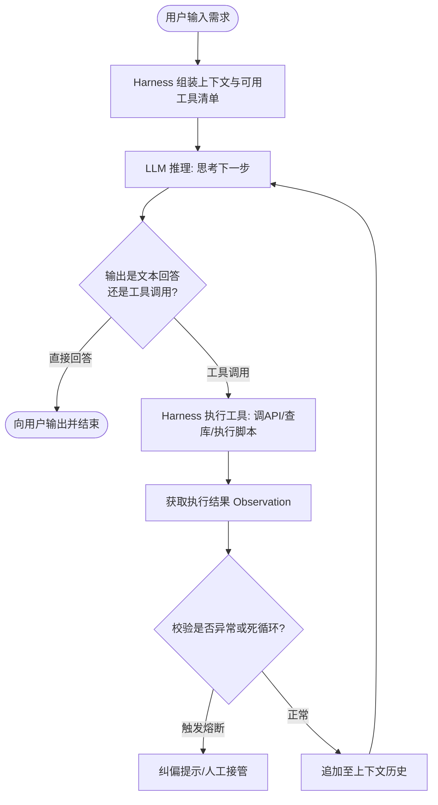

# 《深入理解 AI Agent：设计原理与工程实践》技术产品实战全景指南

> **导读**：本文档基于李博杰（Pine AI 联合创始人 / 前微软亚洲研究院研究员）著作《深入理解 AI Agent：设计原理与工程实践》（2026），专为**懂一点技术、关注落地与系统架构的产品经理（Technical PM）和架构师**整理。
>
> 目标：**即使不读原书，也能完整掌握工业级 Agent 的运行机制、设计模式、系统陷阱、评估体系与演进路径，能直接用于指导 PRD 编写与技术评审。**

---

## 目录

1. [心智模型：为什么做 Agent 这么难？](#一心智模型为什么做-agent-这么难)
2. [运行时剖析：一个 Agent 究竟是怎样跑起来的？](#二运行时剖析一个-agent-究竟是怎样跑起来的)
3. [上下文工程：决定系统智商与调用成本的核心战场](#三上下文工程决定系统智商与调用成本的核心战场)
4. [记忆与知识系统：跨越单次会话的持久化智能](#四记忆与知识系统跨越单次会话的持久化智能)
5. [工具体系（ACI）：给 Agent 配备安全的手脚](#五工具体系aci给-agent-配备安全的手脚)
6. [Coding Agent：为什么通用 Agent 的底层内核都是写代码？](#六coding-agent为什么通用-agent-的底层内核都是写代码)
7. [多模态与交互扩展：走出文字框的 Agent](#七多模态与交互扩展走出文字框的-agent)
8. [评估工程（Evaluation）：Agent 产品的北极星与生命线](#八评估工程evaluationagent-产品的北极星与生命线)
9. [持续进化与模型后训练：系统如何变聪明？](#九持续进化与模型后训练系统如何变聪明)
10. [多 Agent 协作：真需求还是过度工程？](#十多-agent-协作真需求还是过度工程)
11. [PM 核心自查清单与设计守则（20 条戒律）](#十一pm-核心自查清单与设计守则20-条戒律)

---

## 一、心智模型：为什么做 Agent 这么难？

在做传统大模型产品（如问答助手、摘要生成）时，写一段好的 Prompt 往往就能拿到 80 分的 Demo。但一旦进入 Agent 领域，团队往往会遭遇断崖式挫败：**Demo 惊艳，上线即崩溃**。

### 1.1 复合概率的诅咒（Compounding Error）

这是所有 Agent 产品经理必须理解的第一个数学事实：

```
假设你的 Agent 需要执行 10 个连续步骤完成一次订票+退改签操作。
即便底座大模型每一步的判断准确率高达 95%（0.95）：
整体任务成功率 = 0.95^10 ≈ 59.87%
如果流程扩展到 20 步：
整体任务成功率 = 0.95^20 ≈ 35.85%
```

**单步看似高可用（95%），串联起来就是完全不可用的垃圾系统（不到 60%）**。只要其中某一步格式解析失败、参数提取偏航或调用工具超时，后续所有步骤都会在错误的基础上不断漂移（Error Cascade）。

### 1.2 核心公式：Agent = Model + Harness

很多人以为 Agent 的能力完全取决于底座模型（GPT-4、Claude 3.5、DeepSeek-R1）。原书提出了一个工业界的核心共识：

$$\boxed{\text{Agent} = \text{Model（引擎）} + \text{Harness（底盘与驾驶辅助系统）}}$$

- **Model（大模型）**：负责意图理解与临时决策。它具有随机性、容易遗忘、会产生幻觉。
- **Harness（外围控制工程）**：包含上下文组装、工具协议转换、安全拦截、输出格式校验、执行沙箱、自动重试和错误恢复。

> **产品启示**：当业务场景失败时，不要第一时间抱怨“模型不够聪明，等下一代模型”，而要问：**我们的 Harness 是否给它提供了足够精确的观察（上下文）、鲁棒的动作工具、以及出问题时的纠偏与回滚机制？**

---

## 二、运行时剖析：一个 Agent 究竟是怎样跑起来的？

### 2.1 底层真相：大模型 API 是绝对无状态的（Stateless）

很多非技术产品常犯的认知错误是：以为模型像个常驻内存的程序，会一直“记住”刚才说的话。
**真相是：LLM API 没有任何会话记忆，每一次交互都是纯粹的无状态函数调用。**

为了实现连续对话与多步思考，Agent 框架在每一轮与大模型交互时，都在把**从盘古开天辟地以来的全部历史消息重组为一个巨大列表**再次发给模型：

```
第 1 轮: [System] + [User 需求] ──→ 模型决定调用工具 A
第 2 轮: [System] + [User 需求] + [Assistant 调工具A] + [Tool A返回结果] ──→ 模型决定调用工具 B
第 3 轮: [System] + [User 需求] + [Assistant 调工具A] + [Tool A返回] + [Assistant 调工具B] + [Tool B返回] ──→ 模型输出最终回答
```

随着轮数增加，输入给模型的 Token 呈几何级膨胀，成本暴增、速度变慢，且旧信息会逐渐稀释模型的注意力。

### 2.2 ReAct 闭环（Reasoning + Acting）

现代 Agent 的基础循环是 ReAct，即“**思考（Thought） $\to$ 行动（Action） $\to$ 观察（Observation）**”：



### 2.3 为什么 Agent 会死循环？如何打破？

在真实运行中，Agent 最常见的 Bug 之一是**循环鬼打墙**：调用工具 A 报错 $\to$ 再次用相同的参数调用工具 A $\to$ 再次报错……
- **原因**：大模型没有全局状态计数器，长上下文中它记不清自己已经试了几次。
- **解法**：在 Harness 层实现 **Agent 状态栏（Status Bar）**，在每轮上下文最末端强行注入显式元数据：
  `[系统提示：当前已重试 3/5 次，工具 query_user 连续报错 2 次，请勿再次尝试相同参数，请尝试换用备用工具或直接询问用户]`。

---

## 三、上下文工程：决定系统智商与调用成本的核心战场

上下文是 Agent 的眼睛。大模型能做什么，完全取决于此时此刻它的上下文窗口里装了什么。

### 3.1 为什么你在 Prompt 开头加个时间戳，公司会多花几十万？

这里涉及到大模型推理最重要的基石：**KV Cache 与 Prompt Cache（提示词缓存）**。
- **机制**：当大模型处理请求时，需要把前面的 Token 转化为 Key-Value 向量矩阵。如果新请求的**前缀 Token 序列与上一请求完全相同**，云厂商（如 Anthropic、OpenAI、DeepSeek）就可以直接复用内存中的 KV Cache，命中缓存的 Token 通常**便宜 75%~90%，且首字延迟（TTFT）大幅下降**。
- **灾难设计**：如果工程师或 PM 在 System Prompt 的开头拼接了动态内容（比如 `当前时间是: 2026-10-28 14:32:05`），那么每一秒这个前缀都在变化，**导致整篇几千甚至上万 Token 的 System Prompt 永远无法命中缓存**！

> **架构铁律**：**前缀只增不改，动态信息永远追加在末尾！**
> 系统提示词和工具 Schema 必须在字节级别保持绝对稳定。动态变量（时间、电量、当前网络状态）统统放到最新一轮的 User 消息末尾传入。

### 3.2 Agent Skills：解决“工具太多把模型搞蠢”的渐进式披露

如果给 Agent 配置 100 个业务工具的定义（JSON Schema），每次请求光工具说明就要吃掉上万 Token，不仅贵，而且模型很容易挑错工具。

原书推崇的架构是 **渐进式披露（Progressive Disclosure）**，即 **Agent Skills 机制**：
1. **L0 层（目录常驻）**：在系统提示词中只放极简的 Skill 索引列表（每项只占 1 行：技能名 + 适用场景一句话描述）。
2. **L1 层（按需加载正文）**：当用户提到“帮我处理 PDF 发票”时，Agent 先调用内置的 `load_skill("pdf_invoice")` 工具，把这份技能的详细指南与专属参数注入到当前上下文。
3. **L2 层（执行完毕隔离/卸载）**：任务完成后，不让庞大的细则污染主干历史。

### 3.3 治标与治本：隔离优于压缩

当会话太长时，很多团队的第一反应是“让 LLM 把前 10 轮对话总结成一段摘要”，即上下文压缩。
**原书明确指出：隔离优于压缩！**
- **摘要的缺陷**：有损压缩。摘要往往会丢掉关键细节（如某个临时订单号、特殊的边界条件约束），且模型重新读取摘要很容易再次产生认知偏差。
- **最佳解法：子 Agent 物理隔离**。主 Agent 需要遍历检索 50 篇长文档时，**不要把 50 篇文档捞到主会话中**，而是 Spawn 一个临时子 Agent：“你去查这 50 篇文档，找出与退款相关的段落，只把最终整理好的 3 条结论回传给我”。子 Agent 执行完后整片上下文连同中间垃圾一同丢弃。

---

## 四、记忆与知识系统：跨越单次会话的持久化智能

### 4.1 记忆的三层结构

```
┌────────────────────────────────────────────────────────┐
│ 1. 基础回忆（Recall）                                  │
│    用户说：“我叫张三，我喜欢红茶” ──> 能够记录并在被问时答出    │
├────────────────────────────────────────────────────────┤
│ 2. 多会话检索（Cross-Session Retrieval）               │
│    下周新会话中用户说：“再买点我常喝的” ──> 检索出红茶并下单  │
├────────────────────────────────────────────────────────┤
│ 3. 主动服务（Proactive Service）                       │
│    检测到天气骤降，主动结合用户过敏史提醒备药（需极高置信度）   │
└────────────────────────────────────────────────────────┘
```

### 4.2 记忆格式演进：从文本便签到 User as Code

| 格式 | 优点 | 缺点 | 适用阶段 |
|:---|:---|:---|:---|
| **Simple Notes**（平铺文本记录） | 极度灵活，开发快 | 无法做精确查询，冲突难以消解 | 早期 MVP |
| **JSON Cards**（分类卡片标签） | 结构清晰（喜好/设备/家庭） | 关系表达弱，跨分类推导差 | 成熟业务 |
| **User as Code**（类型化代码状态） | 用代码结构定义画像，冲突由逻辑函数仲裁 | 技术门槛高 | 强严谨性金融/医疗场景 |

### 4.3 生产级 RAG 的混合检索闭环

单纯用向量数据库做语义搜索（Dense Retrieval）经常发生灾难性翻车（例如搜“iPhone 15 Pro”，向量把“iPhone 14 Pro”排在前面，因为语义极度相似）。
工业级 RAG 必须走**混合检索流水线**：

```
用户输入 Query
      ├──> 语义稠密检索（Dense Vector / Embedding）──> 覆盖泛化意图
      └──> 关键词稀疏检索（Sparse BM25 / Elastic）  ──> 精确匹配型号、专有名词、错误码
                     │
                     ▼
         RRF（Reciprocal Rank Fusion）融合双路排名
                     │
                     ▼
          Cross-Encoder 重排序（Rerank 模型精排，取 Top 3-5）
                     │
                     ▼
                 送入上下文
```

### 4.4 记忆变更的 PR 闭环（Proposer-Reviewer）

**铁律：绝对不能让 Agent 在对话过程中直接把内容写入核心长期记忆库！**
Agent 会受到各种外部诱导甚至恶意注入。正确的记忆更新必须采用类 GitHub PR 模式：
1. **提议（Proposer）**：在线 Agent 从会话中提炼记忆候选条目（`User: 喜欢极简风格`）。
2. **离线审核（Reviewer）**：在离线服务（睡眠学习）中，由独立的审核模型结合历史记录核对，检查是否与已知事实冲突、是否包含敏感隐私。
3. **合并（Merge）**：确认无误后打补丁合并入库。

---

## 五、工具体系（ACI）：给 Agent 配备安全的手脚

### 5.1 ACI 原则：面向 Agent 设计接口，而不是复用人用的 REST API

传统 REST API 是给程序员和前端写的，参数层级深、错误码繁多。直接塞给 Agent 往往容易导致填错参数。
**ACI（Agent-Computer Interface）设计要点**：
- **扁平化参数**：尽量拍平成顶层基本数据类型，避免深层嵌套 JSON。
- **宽容的参数解析**：如果用户输入带逗号或空格，工具层代码自行预处理，而不是报错抛给模型。
- **高保真描述（Description）**：工具描述中不仅要写“这个工具是干什么的”，更要写**“什么时候绝对不要用它”**以及**“如果想做 X 请改用 Y”**的反例与边界。

### 5.2 工具执行的分层防御架构

```
Agent 发起 Tool Call
         │
         ├──> 1. 输入层合法性校验（Pydantic Schema 校验格式、类型）
         ├──> 2. Sidecar 隐形安全门控（独立小模型/规则匹配：是否越权？是否转账高危操作？）
         ├──> 3. 隔离执行沙箱（Sandbox：Docker/gVisor 隔离环境，只开放特定网络出口）
         ├──> 4. 幂等性控制（Idempotency Key：防止 Agent 重复扣款或重复下单）
         └──> 5. 结果截断与脱敏（工具返回 10 万行日志时，自动截断首尾 50 行，其余写盘存文件）
```

---

## 六、Coding Agent：为什么通用 Agent 的底层内核都是写代码？

从 Claude Code、Cursor 到 Manus、OpenClaw，大家发现：**凡是在复杂开放任务中表现优异的通用 Agent，其底层几乎都是 Coding Agent（写代码 + 调终端）**。

### 6.1 为什么是代码？

很多产品经理以为代码只是用来“做软件开发”的，其实代码是 Agent 的**通用元能力**：
1. **解决数学与逻辑**：让大模型直接心算“13847 × 9283”容易胡说八道；让它写一行 `print(13847 * 9283)` 并由 Python 解释器执行，**准确率 100%**。
2. **复杂 API 组合调用**：如果需要“调接口 A 获取列表，对每个结果调接口 B，最后排序过滤”，传统工具调用需要往返交互几十轮；而让 Agent 写一段 Python 脚本一次性执行，**耗时缩短 90%，且中间状态不污染上下文**。
3. **天然具备全套 Harness**：软件工程几十年积累了全球最完善的纠错工具箱——**语法检查器（Linter）、编译器、单元测试、Git 回滚**。Agent 代码写错了，编译器会精确返回行号和报错，模型拿到反馈就能自动修复（Self-debugging）。

---

## 七、多模态与交互扩展：走出文字框的 Agent

现实世界的任务不是“一问一答的回合制游戏”。原书提炼了从文字走向多模态与真实环境的核心原语。

### 7.1 五大交互原语

任何复杂的交互型 Agent（车载语音、GUI 手机助手、机器人），在系统架构上都必须支持这五大约束：

| 原语 | 含义与产品意义 |
|:---|:---|
| **唤醒（Wakeup）** | 支持事件驱动、定时器、传感器阈值主动唤醒，而不只是等待用户敲回车 |
| **安全点（Safepoint）** | 在每一步工具调用与动作之间设立检查点，确保外部可以随时接管 |
| **取消（Cancel）** | 用户喊“停”或关闭窗口时，后台已经发出的级联任务能瞬间级联终止 |
| **抢占（Preempt）** | 高优先级事件（如碰撞预警、来电）能够瞬间打断正在进行的闲聊生成 |
| **快慢分离（Dual-path）** | 前台毫秒级反馈（System 1 先行安抚）+ 后台高延迟深度规划（System 2） |

### 7.2 Computer Use（GUI 自动化）的核心避坑：永远闭环验证

很多做 GUI 操作（点屏幕、点网页）的 Agent 容易陷入盲目执行：
- 以为点了一下“提交”按钮就成功了，接着去点下一个按钮；
- 实际上网络卡顿导致网页还没加载出来，后续所有点击全部点空。

> **产品铁律**：**动作之后必须有观察（Verify State）！**
> 点击操作之后，必须强制调用截图或 DOM 检查工具，确认页面状态确实发生了预期迁移，再允许进行下一步。

---

## 八、评估工程（Evaluation）：Agent 产品的北极星与生命线

### 8.1 两个核心指标：分清“看戏”与“买单”

这是整个 Agent 评估中最重要的量化分水岭：

$$\text{Pass@}k = 1 - (1-p)^k \qquad \text{vs} \qquad \text{Pass}^k = p^k$$

- **$\text{Pass@}k$（技术上限指标）**：让 Agent 跑 $k$ 次，只要有 1 次成功就算成功。这是学术界刷榜、发发布会 Demo 最喜欢用的指标。
- **$\text{Pass}^k$（商业可靠性指标）**：让 Agent 连续跑 $k$ 次任务，**必须每一次都成功**。这是企业级商业客户愿不愿意付费的唯一标准。

```
如果单次任务成功率 p = 0.8（80%）：
Pass@5 = 1 - (0.2)^5 = 99.96%（发布会上可以说“我们有能力搞定 99.9% 的场景！”）
Pass^5 = (0.8)^5 ≈ 32.7%（真实客户用 5 次，有近 70% 的概率会遇上至少一次故障被劝退）
```

### 8.2 失败归因：必须定位首个错误（First Mistake）

当一个运行了 20 步的 Agent 最终任务失败报错时，日志最后一行通常是 `Database Timeout`。
初级工程师会去排查数据库性能；
**成熟的 Agent PM 会往前倒推，找整个执行链条上偏离正轨的第一步（First Mistake）**：
- 是在第 3 步提取参数时把日期格式搞错了，导致第 8 步生成的 SQL 条件离谱，最终在第 20 步拖垮了数据库。
- **改进必须作用在首错发生处**，否则在末端做再多补丁都是徒劳。

---

## 九、持续进化与模型后训练：系统如何变聪明？

### 9.1 SFT 记忆，RL 泛化

对于技术 PM，不需要懂反向传播公式，但必须理解后训练（Post-training）的分工：
- **SFT（监督微调）**：给模型看大量“标准优秀示范”。它的本质是教模型**学会格式、遵循协议、记住特定领域的术语和调用规范**（相当于应试背题）。
- **RL（强化学习）**：建立一个确定性的**验证器（Verifier / Environment）**，给模型目标让它自己不断试错。答对了给奖励，越界了给惩罚。RL 能够让模型探索出超越示范数据的**通用泛化策略与长程纠偏能力**。

### 9.2 在线离线双循环（双集验证防退化）

Agent 系统不能像人类一样在线实时更新权重（极易造成策略崩溃和不可逆安全事故）。
安全进化的工程标准是**双循环架构**：

```
┌────────────────────────────────────────────────────────┐
│ 在线循环（Online）                                      │
│ 只负责稳定执行，并将全链路 Trajectory（轨迹日志）不可变归档   │
└──────────────────────────┬─────────────────────────────┘
                           │ 每日/每周批量回流日志
                           ▼
┌────────────────────────────────────────────────────────┐
│ 离线循环（Offline 睡眠学习）                            │
│ 1. 聚类挖掘 Badcase                                     │
│ 2. 算法工程师提出优化 Proposal（改 Prompt / 加 Skill / 调参数） │
│ 3. 必须同时跑通两大验证集：                               │
│    - 边界集（Boundary Set）：验证那些曾经失败的 Case 是否修好了 │
│    - 保留集（Retain Set）：严防过度矫正，确保原来正确的没被改坏  │
│ 4. 通过门禁后，才允许灰度上线发布                         │
└────────────────────────────────────────────────────────┘
```

---

## 十、多 Agent 协作：真需求还是过度工程？

多 Agent 协作（Multi-Agent）是近两年概念炒作最严重的领域。很多团队设计了“产品经理 Agent + 架构师 Agent + 程序员 Agent + 测试 Agent”的复杂辩论流水线，结果发现又慢又贵又难用。

### 10.1 多 Agent 增益的唯一判据

原书给出了极具穿透力的一条判断标准：

> **多 Agent 协作优于单 Agent 的唯一前提，是这种协作是否引入了外部的“新信息”反馈！**

- **伪需求**：让两个语言模型在那儿互相文本审查、自我辩论（LLM 自审盲区是一致的，只是在平白无故浪费 Token 和延迟）。
- **真需求**：
  1. **提议者-审核者（Proposer-Reviewer）**：一个 Agent 写代码，由真实沙箱环境执行编译；另一个异构审查 Agent 看着真实的报错信息或渲染出来的截图进行评估（引入了编译运行与视觉新信息）。
  2. **物理上下文隔离**：子 Agent 去深挖海量脏数据，提炼出精简结论后再交回主上下文，避免主 Agent 认知过载。

---

## 十一、PM 核心自查清单与设计守则（20 条戒律）

在你设计下一个 Agent 产品或评审 PRD 时，请用这 20 条标准逐一核对：

### 架构与上下文
1. [ ] **无状态心智**：是否清楚系统每一次交互都需要重构历史上下文？
2. [ ] **缓存纪律**：System Prompt 和工具定义是否完全静态，绝不在前缀中夹带当前时间戳或动态变量？
3. [ ] **隔离胜过压缩**：对于海量信息探索，是否采用了临时子 Agent 隔离噪声，而非粗暴的全文摘要？
4. [ ] **状态显式化**：重试次数、剩余步骤、已尝试方案是否由 Harness 作为状态栏显式追加给模型？

### 工具与接口（ACI）
5. [ ] **面向 Agent 的工具设计**：工具入参是否扁平？错误提示是否包含清晰的修正建议？
6. [ ] **工具描述有边界**：是否写清楚了“何时用”以及“何时绝对不要用”的反例？
7. [ ] **工具披露渐进式**：高频核心工具常驻，长尾技能是否采用了 Skill 按需加载机制？
8. [ ] **执行工具必隔离**：代码执行是否在沙箱中？是否严格限制了网络出口与写权限？
9. [ ] **幂等性保障**：涉及资金、发信、数据修改的工具是否配置了全局唯一幂等 Key？
10. [ ] **高危操作异构双审**：不可逆破坏性操作是否经由不同家族的审查模型或人工（HITL）确认？

### 交互与安全
11. [ ] **动作必有验证**：GUI 点击或硬件操作后，是否强制通过新观察闭环核验状态迁移？
12. [ ] **快慢双通道**：高频确定性意图是否直接 Bypass 编排器毫秒级直达，仅长尾复合意图走多步推理？
13. [ ] **全链路可取消**：用户下达终止口令时，是否能级联打断后台正在执行的异步工具链？
14. [ ] **提示注入三层设防**：外部不可信网页与数据是否打上了数据标签，防止其伪装为系统指令提权？

### 评估与迭代
15. [ ] **紧盯业务可靠性**：除了看宣传用的 $Pass@k$，是否严格测量并监控商用级的 $Pass^k$？
16. [ ] **归因定位首错**：分析长轨迹失败用例时，是否将矛头对准导致偏差的第一个错误？
17. [ ] **评判模型去偏**：使用 LLM-as-a-Judge 时，是否对调候选展示顺序以消除位置偏见？
18. [ ] **双集验证门禁**：优化 Prompt 或微调权重时，是否同时跑了边界集（防没修好）和保留集（防退化）？
19. [ ] **记忆更新走 PR 流程**：用户长期画像与知识变更是否异步脱敏核实，杜绝实时直接覆写？
20. [ ] **多 Agent 引入新信息**：系统拆分成多个 Agent 时，是否确保每个角色都有独立的外部输入通道？
