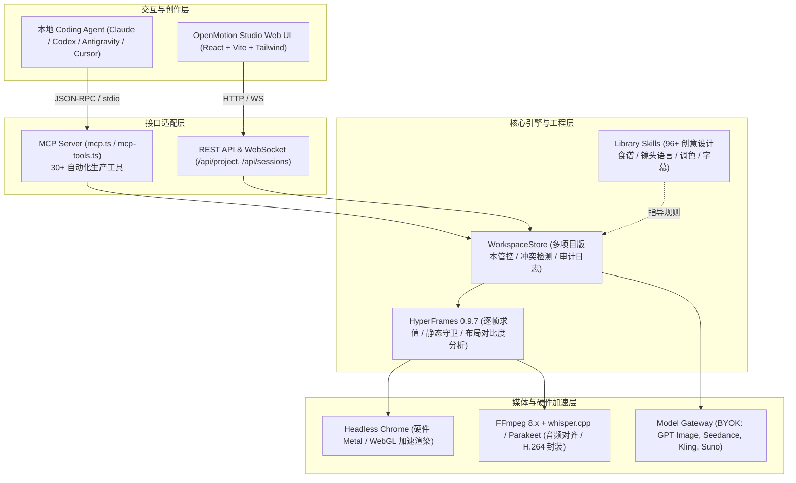
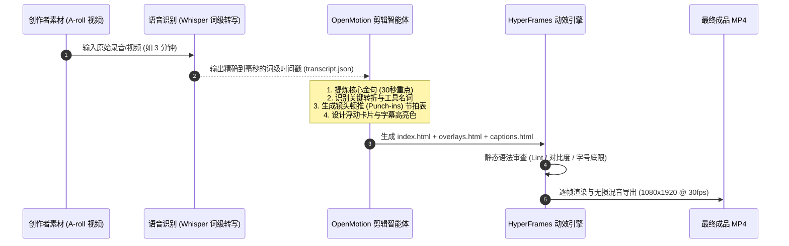
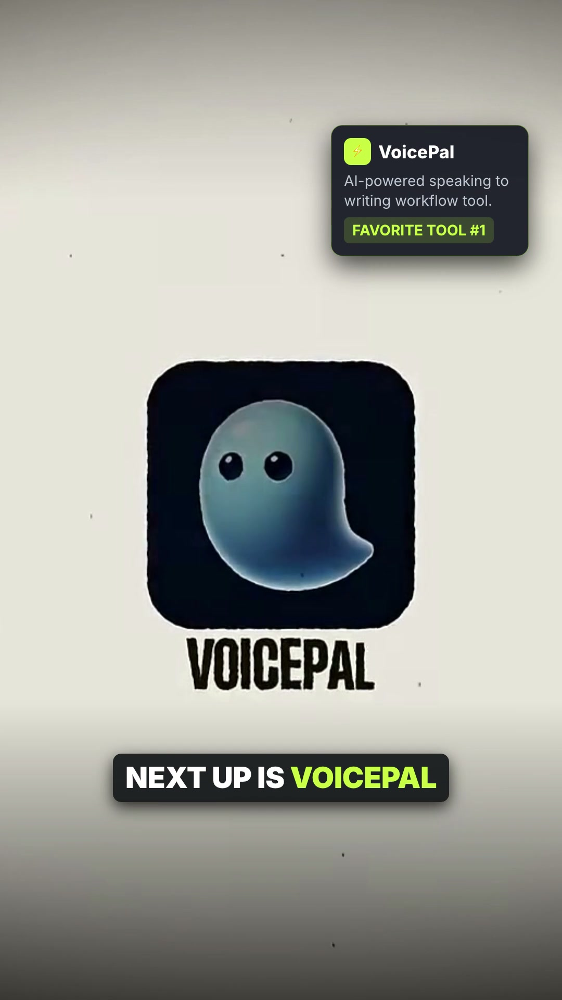

# OpenMotion 完整入门与实战开发指南

> **OpenMotion** 是由 AI Agent 驱动的开源全栈视频创作工作台，致力于成为 **Claude Motion 与 CapCut（剪映）的开源替代方案**。它倡导 **“视频即代码（Video as Code）”** 的设计哲学，基于原生 Web 标准技术栈（HTML、CSS、JavaScript 与 GSAP 动画时间轴），依托 **HyperFrames** 确定性无损渲染引擎，让开发者与视频创作者既能通过可视化 Web Studio 交互剪辑，也能通过本地 Agent（如 Claude Code、Codex、Antigravity 等）实现全自动分镜拆解、素材复刻与高清渲染。

---

## 目录

1. [核心架构与设计理念](#1-核心架构与设计理念)
2. [环境准备与服务启动](#2-环境准备与服务启动)
3. [双模创作工作流（Studio UI 与 Agent MCP）](#3-双模创作工作流studio-ui-与-agent-mcp)
4. [工程体系与 HyperFrames 规范](#4-工程体系与-hyperframes-规范)
5. [深度实战：AI 口播精剪（AI Talking-Head Edits）](#5-深度实战ai-口播精剪ai-talking-head-edits)
6. [质量门禁与渲染导出（Check & Export）](#6-质量门禁与渲染导出check--export)
7. [常见问题与避坑指南（FAQ）](#7-常见问题与避坑指南faq)

---

## 1. 核心架构与设计理念

### 1.1 为什么选择 OpenMotion？

在传统视频创作与主流 AI 视频工具中，创作者常面临三大瓶颈：
1. **黑盒生成不可控**：纯文生视频或商业工具模板大多是“黑盒”，无法对镜头中的文字排版、转场曲线、关键元素位置进行像素级精确微调；
2. **Web 录屏丢帧卡顿**：基于浏览器 Canvas 实时录制的方案在复杂动画或硬件受限时极易丢帧、花屏且音画不同步；
3. **Agent 无法深度参与制作**：现存剪辑软件缺少标准开放接口，大模型无法直接介入项目工程的高效读写与质量审核。

**OpenMotion 的破局解法：**
* **视频即代码（Deterministic Rendering）**：每个视频都是一份标准的静态 Web 工程。通过暂停 GSAP 时间轴并逐帧步进求值（Deterministic Frame Stepping），即使在普通笔记本上也能无损渲染出 60fps 4K 广播级视频。
* **BYOA（自带 Agent）与 BYOK（自带 API 密钥）**：不绑定任何中心化平台，原生支持 22+ 款本地编程智能体（Claude Code、Codex、Antigravity、OpenCode、Pi、Cursor 等），通过标准 Model Context Protocol（MCP）直接接管工程创建、分镜重构与导出。
* **Motion.md 规范与设计系统**：沉淀了 96+ 套专业风格食谱（Library Skills），把复杂的动效规则、卡片节奏、镜头顿推（Punch-ins）提炼为标准规范文档。

### 1.2 系统架构拓扑



---

## 2. 环境准备与服务启动

### 2.1 系统依赖要求

* **操作系统**：macOS (Apple Silicon M 系列芯片最佳), Linux, Windows (WSL2)
* **Node.js**：`>= 22.18.0`（推荐使用 nvm 或 fnm 管理）
* **多媒体工具链**：
  * **FFmpeg & FFprobe**：`>= 7.0`（用于视音频解封装、无损混音与帧抽取）
  * **Google Chrome**：系统自带 Chrome 或由 HyperFrames 自动拉取无头 Chrome
  * **whisper.cpp**（可选）：用于本地毫秒级词级语音转写（`whisper-cli`）

```bash
# macOS 下快速安装必要系统工具
brew install ffmpeg node
```

### 2.2 克隆与本地启动

```bash
# 1. 浅克隆仓库源码
git clone --depth 1 https://github.com/nexu-io/openmotion.git
cd openmotion

# 2. 安装依赖并构建 Studio 界面
npm ci
npm run build:studio

# 3. 启动开发与预览服务
npm start
```

### 2.3 常用管理脚本速查

仓库根目录提供了标准化服务管理脚本：

```bash
# 检查当前后台服务状态、进程 PID 与 Studio 端口
bash status_studio.sh

# 后台启动 Studio 服务
bash start_studio.sh

# 停止正在运行的 Studio 服务
bash stop_studio.sh
```

> **注意**：服务启动后会常驻在本地端口（如 `http://localhost:51350`），数据默认存储在 `~/.openmotion/data`（可通过环境变量 `MOTION_DATA_DIR` 覆盖）。

---

## 3. 双模创作工作流（Studio UI 与 Agent MCP）

### 3.1 模式一：可视化 Studio 交互

在浏览器中打开 `http://localhost:51350/#project/project` 即可进入 OpenMotion Studio：
* **多轨道时间轴**：直观展示视频层（Track 0）、图形动效层（Track 1）、字幕层（Track 2）与音频轨道；
* **实时画框检查**：内置 90% 动作安全区（Action-safe）与 80% 字幕标题安全区（Title-safe）参考线；
* **属性热更新**：修改 HTML 中的 `data-var-*` 变量或 CSS 样式，画框毫秒级实时重绘；
* **一键导出**：点击右上角导出按钮，后台自动触发 HyperFrames 无头渲染并生成 MP4。

### 3.2 模式二：Agent MCP 自动化驱动

OpenMotion 原生内置完整的 MCP Server。通过配置智能体客户端（如 Claude Code 的 `~/.claude/config.json` 或 Antigravity / Codex 的 MCP 配置），Agent 可以直接调用以下核心生产工具：

| 工具名称 | 核心职责 | 适用场景 |
| :--- | :--- | :--- |
| `openmotion_open_preview` | 初始化工作区并返回当前项目实时 Studio 预览 URL | 会话启动、环境连通性检查 |
| `openmotion_create_session` | 创建独立的创作对话会话与项目空间 | 新视频策划、多版本对比试验 |
| `openmotion_list_templates` | 检索模板库与参考片目录（含 A-roll 口播、产品发布等） | 寻找创作参照物与节奏模板 |
| `openmotion_inspect_project` | 调用静态语法守卫检查项目（`info`, `timeline`, `lint`） | 代码编写后、渲染前的语法与规范审查 |
| `openmotion_write_files` | 带版本保护（revision lock）原子写入工程文件 | Agent 批量修改或创建视频代码 |
| `openmotion_import_asset` | 导入本地视频素材、音频、字体或设计图到 `assets/` | 准备本地素材 |
| `openmotion_request_export` | 触发后台无头无损 MP4 渲染队列 | 提交最终渲染任务 |
| `openmotion_verify_export` | 针对导出的真实 MP4 执行比特流解码与技术指标验收 | 校验分辨率、帧率、音频同步与哈希 |

配置示例（`claude_mcp_config.json`）：

```json
{
  "mcpServers": {
    "openmotion": {
      "command": "node",
      "args": ["--experimental-strip-types", "/Users/fx/wk/github/openmotion/mcp.ts"],
      "env": {
        "MOTION_DATA_DIR": "/Users/fx/.openmotion/data"
      }
    }
  }
}
```

---

## 4. 工程体系与 HyperFrames 规范

OpenMotion 视频工程遵循严格的模块化解耦规范，工程根目录由以下文件构成：

```
my-video-project/
├── hyperframes.json        # 项目元数据与子目录路径声明
├── index.html              # 根合成（定义总时长、画幅、FPS、挂载子分镜与音视频轨道）
├── assets/                 # 本地媒体资源（视频片段、BGM音频、字体文件、图片）
│   ├── gsap.min.js         # 内置确定性动画运行时
│   └── speaker.mp4         # 录制的高清口播原素材
└── compositions/           # 子合成目录（按分镜或视觉功能拆解）
    ├── overlays.html       # 动效浮层（人名条、提示卡片、B-roll、产品浮窗）
    └── captions.html       # 动态字幕合成（带关键词变色与安全区控制）
```

### 核心编写铁律（Contract）

1. **唯一时间轴归属**：根合成与每个子合成必须拥有一个由 GSAP 控制的暂停时间轴，并挂载到全局对象：
   ```javascript
   window.__timelines = window.__timelines || {};
   window.__timelines["main"] = tl; // 子合成使用对应的 compositionId
   ```
2. **纯函数时间原则**：严禁在合成中调用 `Date.now()`、未设置种子的 `Math.random()`、网络 `fetch()`、`setInterval` 或 `repeat: -1`。所有视觉与状态必须完全由时间轴时刻 $t$ 确定。
3. **媒体声明规范**：
   * 带声视频必须标明 `data-has-audio="true"`，且**严禁带有 `muted` 属性**；
   * 纯画面视频使用 `data-volume="0"`；独立背景音乐使用 `<audio>` 标签并必须声明唯一 `id`。
4. **层级结构清晰**：根合成 `index.html` 仅用于按时间段挂载视频基础流与子分镜（`data-composition-src="compositions/..."`），具体的 HTML 结构与样式放在子合成的 `<template>` 标签中。

---

## 5. 深度实战：AI 口播精剪（AI Talking-Head Edits）

### 5.1 痛点与 AI 口播剪辑逻辑

短视频（Reels, Shorts, TikTok, 视频号）中，单调冗长的单机位真人口播（A-roll）极易导致完播率骤降。
OpenMotion 的 **AI 口播精剪工作流（Talking-Head Recreation）** 通过自动化组合四项关键能力，将一段冗长录制重塑为节奏紧凑的爆款短片：



### 5.2 核心剪辑要素与规范参数

参考行业标杆（如 Ali Abdaal、Dan Martell 的知识分享视频），OpenMotion 定义了以下标准动效参数：

| 剪辑元素 | 标准设计规范 | 推荐参数 / 动效实现 |
| :--- | :--- | :--- |
| **镜头顿推 (Punch-ins)** | 强调关键词或语气转折时瞬间推进，打破单机位沉闷感 | 缩放比例 **115% ~ 120%**，锚点锁定面部中心（`transform-origin: 50% 36%`），在 **120ms** 内硬切推进（`power2.out`） |
| **高对比动效字幕** | 2~4 个单词或短词为一组快速切分，关键词高亮 | 字体字号 **56px+**，白字带半透明深色保护底板，核心关键词采用荧光绿（`#C6FF3D`） |
| **讲者人名条 (Lower Third)** | 开场交代讲者身份与主题 | 屏幕左下方距底 **640px**，深色半透明毛玻璃底板 + 竖向彩色重音条，停留 **1.5 ~ 2.0s** 退出 |
| **工具/数据浮动卡片** | 提到具体 App、工具或清单项时从侧方弹出证据卡片 | 屏幕右上方（`top: 240px, right: 64px`），带图标与两行说明，`back.out` 弹跳入场，停留 **3.0 ~ 3.5s** |

---

### 5.3 真实测试完整实录（Ali Abdaal 工作流精剪）

本次我们在本地环境完整实测了基于 Ali Abdaal 工作流参考片的 AI 口播精剪流程：

#### 第 1 步：素材切片与词级转写

使用本地 FFmpeg 与内置 Whisper 引擎从原片截取 8 秒核心讲述片段并提取精准词级时间戳：

```bash
# 截取 8s 口播片段
ffmpeg -ss 10 -i "https://static.heygen.ai/hyperframes-oss/desktop/viral-clone/ali-abdaal-workflow-reference.mp4" \
  -t 8 -c:v copy -c:a aac /tmp/ali-abdaal-8s.mp4 -y

# 运行词级转写
node node_modules/hyperframes/bin/hyperframes.mjs transcribe /tmp/ali-abdaal-8s.mp4 --model tiny.en --json
```

转写生成的词级时间戳示例：
```json
[
  { "text": "directly", "start": 0.83, "end": 1.18, "id": "w4" },
  { "text": "talk",     "start": 1.18, "end": 1.31, "id": "w5" },
  { "text": "VoicePal", "start": 2.15, "end": 2.56, "id": "w12" },
  { "text": "writing",  "start": 5.73, "end": 6.12, "id": "w31" }
]
```

#### 第 2 步：构建主合成 `index.html`（9:16 竖屏）

```html
<!doctype html>
<html lang="en">
<head>
  <meta charset="utf-8">
  <title>OpenMotion · AI Talking-Head Edit</title>
  <script src="assets/gsap.min.js"></script>
  <style>
    * { box-sizing: border-box; }
    body { margin: 0; background: #000; overflow: hidden; }
    #main {
      position: relative;
      width: 1080px;
      height: 1920px;
      overflow: hidden;
      background: #0a0b0e;
    }
    #speaker-video {
      position: absolute;
      top: 0; left: 0;
      width: 1080px; height: 1920px;
      object-fit: cover;
      transform-origin: 50% 36%;
    }
  </style>
</head>
<body>
  <div id="main" data-composition-id="main" data-start="0" data-duration="8" data-width="1080" data-height="1920" data-fps="30">
    <!-- 视频底层：支持镜头推进动画 -->
    <video id="speaker-video" class="clip" data-start="0" data-duration="8" data-has-audio="true" src="assets/speaker.mp4" data-track-index="0" playsinline></video>

    <!-- 图形浮层：人名条与工具卡片 -->
    <div id="overlays" class="clip" data-composition-id="overlays" data-composition-src="compositions/overlays.html" data-start="0" data-duration="8" data-track-index="1" data-track-kind="graphics" data-width="1080" data-height="1920"></div>

    <!-- 字幕层：高对比度快切字幕 -->
    <div id="captions" class="clip" data-composition-id="captions" data-composition-src="compositions/captions.html" data-start="0" data-duration="8" data-track-index="2" data-track-kind="captions" data-width="1080" data-height="1920"></div>
  </div>

  <script>
    const tl = gsap.timeline({ paused: true });
    // 节拍 1：在 1.8s 处说到 "Next up is VoicePal" 时瞬间推进 118%
    tl.to("#speaker-video", { scale: 1.18, duration: 0.14, ease: "power2.out" }, 1.8);
    // 节拍 2：在 5.5s 处平缓拉回标准景别
    tl.to("#speaker-video", { scale: 1.0, duration: 0.2, ease: "power2.inOut" }, 5.5);

    window.__timelines = window.__timelines || {};
    window.__timelines.main = tl;
  </script>
</body>
</html>
```

#### 第 3 步：构建图形浮层 `compositions/overlays.html`

```html
<template>
<style>
#overlays { position: absolute; inset: 0; width: 1080px; height: 1920px; pointer-events: none; }
.scrim {
  position: absolute; inset: 0;
  background: linear-gradient(180deg, rgba(0,0,0,0.25) 0%, transparent 20%, transparent 70%, rgba(0,0,0,0.7) 100%);
}
#speaker-tag {
  position: absolute; left: 64px; bottom: 640px;
  display: flex; align-items: center; gap: 16px;
  background: rgba(15, 18, 26, 0.88);
  border: 1px solid rgba(255, 255, 255, 0.15);
  border-left: 6px solid #C6FF3D;
  padding: 16px 28px; border-radius: 14px;
  backdrop-filter: blur(24px);
}
.speaker-name { font-size: 32px; font-weight: 800; color: #fff; }
.speaker-title { font-size: 28px; font-weight: 700; color: #C6FF3D; text-transform: uppercase; }

#tool-card {
  position: absolute; top: 240px; right: 64px; width: 380px;
  background: rgba(18, 22, 34, 0.92);
  border: 1px solid rgba(198, 255, 61, 0.4);
  border-radius: 22px; padding: 24px;
  backdrop-filter: blur(28px);
}
.card-header { display: flex; align-items: center; gap: 14px; }
.card-icon {
  width: 52px; height: 52px; background: #C6FF3D; border-radius: 14px;
  display: flex; align-items: center; justify-content: center;
  font-size: 26px; font-weight: 900; color: #0b0d13;
}
.card-title { font-size: 34px; font-weight: 800; color: #fff; }
.card-desc { font-size: 28px; line-height: 1.35; color: #c0c8d4; }
.card-tag {
  align-self: flex-start; font-size: 28px; font-weight: 700; color: #C6FF3D;
  background: rgba(198, 255, 61, 0.15); padding: 8px 16px; border-radius: 10px;
}
</style>

<div id="overlays" class="film-scene" data-composition-id="overlays" data-duration="8" data-width="1080" data-height="1920">
  <div class="scrim"></div>
  <div id="speaker-tag">
    <div class="speaker-name">Ali Abdaal</div>
    <div class="speaker-title">Daily Workflow</div>
  </div>
  <div id="tool-card">
    <div class="card-header">
      <div class="card-icon">⚡</div>
      <div class="card-title">VoicePal</div>
    </div>
    <div class="card-desc">AI-powered speaking to writing workflow tool.</div>
    <div class="card-tag">Favorite Tool #1</div>
  </div>
</div>

<script>
(() => {
  const tl = gsap.timeline({ paused: true });
  // 人名条在 0.3s 入场，2.0s 退出
  tl.fromTo("#speaker-tag", { opacity: 0, x: -70 }, { opacity: 1, x: 0, duration: 0.35, ease: "back.out(1.4)" }, 0.3);
  tl.to("#speaker-tag", { opacity: 0, x: -50, duration: 0.25, ease: "power2.in" }, 1.75);

  // 工具卡片在 2.0s 伴随顿推弹入，5.2s 退出
  tl.fromTo("#tool-card", { opacity: 0, y: 35, scale: 0.88 }, { opacity: 1, y: 0, scale: 1.0, duration: 0.4, ease: "back.out(1.5)" }, 2.0);
  tl.to("#tool-card", { opacity: 0, scale: 0.92, duration: 0.3, ease: "power2.in" }, 5.2);

  window.__timelines = window.__timelines || {};
  window.__timelines["overlays"] = tl;
})();
</script>
</template>
```

#### 第 4 步：构建动态字幕 `compositions/captions.html`

```html
<template>
<style>
#captions { position: absolute; inset: 0; width: 1080px; height: 1920px; pointer-events: none; }
.caption-cue {
  position: absolute; left: 40px; right: 40px; bottom: 380px;
  text-align: center; font-size: 56px; font-weight: 900; line-height: 1.3;
  text-transform: uppercase; color: #ffffff; opacity: 0;
}
.caption-cue .text-pill {
  background: rgba(10, 12, 16, 0.88);
  padding: 10px 24px; border-radius: 16px; display: inline-block;
  box-shadow: 0 10px 30px rgba(0,0,0,0.8);
}
.caption-cue .kw { color: #C6FF3D; }
</style>

<div id="captions" class="film-scene" data-composition-id="captions" data-duration="8" data-width="1080" data-height="1920">
  <div id="cue-1" class="caption-cue"><span class="text-pill">DIRECTLY <span class="kw">TALK</span> TO THE APP</span></div>
  <div id="cue-2" class="caption-cue"><span class="text-pill">NEXT UP IS <span class="kw">VOICEPAL</span></span></div>
  <div id="cue-3" class="caption-cue"><span class="text-pill">AN APP THAT MY <span class="kw">TEAM AND I</span> BUILT</span></div>
  <div id="cue-4" class="caption-cue"><span class="text-pill">I USE VOICEPAL FOR <span class="kw">WRITING</span> EVERY DAY</span></div>
</div>

<script>
(() => {
  const tl = gsap.timeline({ paused: true });
  // 逐句精准淡入淡出（与音频转写毫秒级对齐）
  tl.fromTo("#cue-1", { opacity: 0, y: 18 }, { opacity: 1, y: 0, duration: 0.15, ease: "power1.out" }, 0.1);
  tl.to("#cue-1", { opacity: 0, duration: 0.1 }, 1.6);

  tl.fromTo("#cue-2", { opacity: 0, y: 18, scale: 0.94 }, { opacity: 1, y: 0, scale: 1.0, duration: 0.15, ease: "back.out(1.2)" }, 1.8);
  tl.to("#cue-2", { opacity: 0, duration: 0.1 }, 3.1);

  tl.fromTo("#cue-3", { opacity: 0, y: 18 }, { opacity: 1, y: 0, duration: 0.15, ease: "power1.out" }, 3.3);
  tl.to("#cue-3", { opacity: 0, duration: 0.1 }, 5.3);

  tl.fromTo("#cue-4", { opacity: 0, y: 18 }, { opacity: 1, y: 0, duration: 0.15, ease: "power1.out" }, 5.5);
  tl.to("#cue-4", { opacity: 0, duration: 0.1 }, 7.8);

  window.__timelines = window.__timelines || {};
  window.__timelines["captions"] = tl;
})();
</script>
</template>
```

---

## 6. 质量门禁与渲染导出（Check & Export）

在真正耗费算力渲染导出前，必须通过 **HyperFrames 综合质量门禁（Check Gate）**。

### 6.1 本地静态与动态检查

```bash
node node_modules/hyperframes/bin/hyperframes.mjs check --dir /Users/fx/.openmotion/data/projects/<project-id> --json
```

**实测审查报告（已完全通过）：**
```json
{
  "ok": true,
  "lint": { "ok": true, "errorCount": 0, "warningCount": 0, "filesScanned": 3 },
  "runtime": { "ok": true, "errorCount": 0, "warningCount": 0 },
  "layout": { "ok": true, "errorCount": 0, "warningCount": 0 },
  "contrast": { "ok": true, "errorCount": 0, "warningCount": 0, "checked": 20, "passed": 20 },
  "craft": { "ok": true, "errorCount": 0, "warningCount": 0 },
  "audio": { "ok": true, "errorCount": 0, "warningCount": 0 }
}
```

* **WCAG AA 对比度审查**：20 个文字采样点全部通过，背景半透明底板保障了复杂背景下的高可读性；
* **Craft 移动端可读字号底限**：所有正文元素字号均保持在 28px 以上，满足竖屏手机快速浏览要求；
* **音频无断音**：视频原声正常被编排进最终渲染音频管道。

### 6.2 高清 MP4 渲染实测

执行实际渲染：
```bash
node node_modules/hyperframes/bin/hyperframes.mjs render \
  --dir /Users/fx/.openmotion/data/projects/<project-id> \
  -o /tmp/talking-head-test.mp4
```

**渲染与比特流参数校验实证：**
* **耗时**：8 秒 1080x1920 高清视频，在 Apple M4 Max 硬件 GPU 加速下仅耗时 **22.3 秒**；
* **文件大小**：**7.35 MB**（7,354,638 字节）；
* **视频比特流**：H.264 High Profile，分辨率 `1080x1920`（9:16 竖屏），帧率精确稳定在 `30 fps`（总帧数 240 帧，无任何丢帧）；
* **音频比特流**：AAC-LC 立体声，采样率 `48,000 Hz`，比特率 `204 kbps`，音画严密对齐。
* **抽帧验证**：



---

## 7. 常见问题与避坑指南（FAQ）

### Q1: `<video>` 标签报 `video_muted_with_declared_audio` 错误？
* **原因**：`<video>` 同时写了 `data-has-audio="true"` 和 HTML 原生 `muted` 属性。
* **解决**：如果该视频包含需要播放的声音，必须移除 `muted` 属性；若是无声背景视频，请移除 `data-has-audio="true"` 并增加 `data-volume="0"`。

### Q2: 提示 `nested_structure_needs_subcomposition` 警告？
* **原因**：HyperFrames 规范要求根合成 `index.html` 只能挂载顶层轨道和子合成，不能直接在根页面嵌套复杂的子元素 `<div>`。
* **解决**：把包含复杂样式的组件拆分到 `compositions/foo.html`，并在根合成中以 `<div class="clip" data-composition-id="foo" data-composition-src="compositions/foo.html">` 方式引入。

### Q3: 为什么检查提示 `text_below_floor`（字号低于底限）？
* **原因**：在 1080x1920 竖屏规格下，手机端人眼能轻松阅读的最小物理字号为 28px。小于 28px 的说明文字会被判定为难以看清。
* **解决**：将文字字号调整至 28px 以上；若是纯视觉装饰条，可添加 `data-layout-ignore` 属性。

### Q4: 提示视频 keyframes 间隔稀疏（sparse keyframes）？
* **原因**：原始拍摄视频的 GOP（关键帧间隔）过大（如超过 3 秒一个 I 帧），在 Studio 手动拖拽时间轴时解码较慢。
* **解决**：通过 FFmpeg 重新注入密集关键帧：
  ```bash
  ffmpeg -i input.mp4 -c:v libx264 -r 30 -g 30 -keyint_min 30 -c:a copy output.mp4
  ```

---

## 8. 总结

OpenMotion 成功将复杂的短视频剪辑工业化、代码化。通过将 **HyperFrames 确定性动画引擎** 与 **AI Agent 的自然语言规划能力** 相结合，创作者无需再耗费大量时间在剪映或 Premiere 中手动切片、对齐字幕和打关键帧。无论是知识博主口播精剪，还是品牌发布、工作流展示，都可以通过标准规范一键复刻与交付。
