# Video as Code 与 Agent 视频创作全景调研与选型指南

> 本文档系统整理了当前主流的“视频即代码（Video as Code）”以及“Coding Agent 辅助视频创作”开源框架，深度对比 **OpenFilm** 与 **OpenMotion**，梳理行业全景方案，并针对**短视频（TikTok / Shorts / Reels / 知识口播）**场景给出具体选型与落地建议。

---

## 目录

1. [核心认知：Video as Code 的范式跃迁](#1-核心认知video-as-code-的范式跃迁)
2. [深度对决：OpenFilm vs OpenMotion](#2-深度对决openfilm-vs-openmotion)
3. [行业全景：主流技术流派横向矩阵](#3-行业全景主流技术流派横向矩阵)
4. [短视频核心诉求拆解与痛点分析](#4-短视频核心诉求拆解与痛点分析)
5. [短视频场景决策树与最终推荐](#5-短视频场景决策树与最终推荐)

---

## 1. 核心认知：Video as Code 的范式跃迁

在生成式 AI 与大模型编程智能体（Claude Code, Codex, Antigravity, OpenCode 等）普及前，视频制作高度依赖图形界面编辑软件（Premiere, After Effects, 剪映/CapCut）。

“视频即代码（Video as Code）”将时间轴、动效、文字排版、转场与媒体资源抽象为**可版本管理、可程序化批处理、可被 Agent 审查与修改的代码工程**：
- **可复现与无损确定性**：消灭录屏丢帧与硬件差异，通过逐帧步进（Deterministic Frame Stepping）在普通笔记本即可渲染 4K 60fps 广播级视频。
- **智能体原生（Agent-Native）**：大模型擅长编写结构化代码（HTML, CSS, TSX, Python），可通过 MCP（Model Context Protocol）或 Git 工作流直接介入剪辑排版。
- **自动化量产与模板化**：支持参数化替换文案、资产与音轨，实现千万级个性化短视频并发交付。

---

## 2. 深度对决：OpenFilm vs OpenMotion

### 2.1 架构拓扑对比

```mermaid
flowchart TD
    subgraph OF ["OpenFilm 架构 (通用协议驱动 / 极简解耦)"]
        A_Agent["Coding Agent (Claude Code / Codex)"] -->|读写 HTML/JS| OF_Files["film.html + scenes/*.html"]
        OF_Studio["OpenFilm Studio (人工微调/锁轨)"] <-->|双向同步| OF_Files
        OF_Files --> OF_Host["Host 环境 (window.filmHost 劫持时钟)"]
        OF_Host --> OF_Func["window.film.frame(t) 纯函数逐帧步进"]
        OF_Func --> OF_Render["Headless Browser / 分布式渲染"]
    end

    subgraph OM ["OpenMotion 架构 (工作台驱动 / 业务全栈)"]
        B_Agent["22+ 本地 Coding Agent"] -->|JSON-RPC / stdio| OM_MCP["MCP Server (30+ 专属生产工具)"]
        OM_Studio["OpenMotion Web Studio (React + Vite)"] -->|REST / WebSocket| OM_API["WorkspaceStore API"]
        OM_MCP --> OM_Engine["HyperFrames 引擎 (0.9.x)"]
        OM_API --> OM_Engine
        OM_Engine --> OM_GSAP["GSAP 时间轴 seek(t) 暂停求值"]
        OM_Engine --> OM_Media["FFmpeg + Whisper.cpp (词级对齐) + AI 模型网关"]
    end
```



### 2.2 核心特性对比表

| 维度 | OpenFilm ([openfilm/openfilm](https://github.com/openfilm/openfilm)) | OpenMotion ([nexu-io/openmotion](https://github.com/nexu-io/openmotion)) |
| :--- | :--- | :--- |
| **项目定位** | 通用 Web 视频文件协议与规范（Protocol 0.1） | 开源版 Claude Motion & 剪映（CapCut）全栈工作台 |
| **设计哲学** | “One HTML file, one function, one real editor” | “Video as Code” 工业化短视频生产管线 |
| **时间轴与工程格式** | 顶层 `film.html`，`<section>` 为轨道，`<video>/<iframe>//<audio>` 为切片 | 顶层 `index.html`，基于 `div.clip` 与 `data-*` 声明式属性组织分镜 |
| **分镜底层机制** | 强制暴露 `window.film = { duration, frame(t), ready }` | 依赖 DOM 布局与 GSAP 动画时间轴 `gsap.timeline({ paused: true })` |
| **时间驱动特性** | **严格函数式**：$\text{frame}(t)$ 必须无状态，Host 严格重写 Date/RAF 与随机种子 | **时间轴步进**：通过 CDP 控制 Headless Chrome 逐帧 `seek(t)` 截图求值 |
| **图形库兼容性** | **完全开放**：Three.js、p5.js、WebGL Shader、Canvas、SVG、原生 DOM 皆可 | **强绑定 Web 前端**：HTML5 + CSS3 + Tailwind + GSAP 动效库 |
| **Agent 交互形态** | 协议/文件系统级读写，`overrides` 动态覆写，支持轨道锁定（`locked`） | **重度 MCP 驱动**：30+ 细粒度工具（工程创建、顿推、切片、排版、样式审查） |
| **内置媒体与 AI 工具** | 纯框架与 Host 引擎，无内置转写或生成模型推理 | 内置 **Whisper 词级转写**、对齐工具、安全区 Linter、生成模型网关（Seedance, Kling, Suno） |
| **设计规范与食谱** | 社区 Skills 代码片段（自由度高） | 96+ 创意食谱（Library Skills）与 **Motion.md** 专业级短视频节奏库 |

### 2.3 代码规范对照

#### OpenFilm：纯函数式 $f(t)$
```html
<!-- film.html -->
<section>
  <iframe id="shot1" src="scenes/title.html" at="0" style="left: 0; top: 0; width: 1080px; height: 1920px"
          overrides='[{"at":"#headline","text":"OpenFilm Spec","style":{"color":"#7fd4ff"}}]'></iframe>
</section>
<section>
  <video src="assets/b-roll.mp4#t=5.0,9.0" at="4.0" speed="1.0" volume="0.8"></video>
</section>
```
```javascript
// scenes/title.html 暴露纯函数接口
window.film = {
  duration: 4.0,
  frame(t) {
    ctx.clearRect(0, 0, width, height);
    const progress = Math.min(1, t / 2.0);
    ctx.fillText("Dynamic Title", 100, 200 * progress);
  }
};
```

#### OpenMotion：基于 GSAP 与 HTML 属性的声明式装配
```html
<!-- index.html -->
<div id="main" data-composition-id="main" data-start="0" data-duration="8" data-fps="30">
  <video id="speaker" class="clip" data-start="0" data-duration="8" src="assets/speaker.mp4" data-track-index="0"></video>
  <div id="overlays" class="clip" data-composition-id="overlays" data-composition-src="compositions/overlays.html" 
       data-start="0" data-duration="8" data-track-index="1" data-track-kind="graphics"></div>
  <div id="captions" class="clip" data-composition-id="captions" data-composition-src="compositions/captions.html" 
       data-start="0" data-duration="8" data-track-index="2" data-track-kind="captions"></div>
</div>
```

---

## 3. 行业全景：主流技术流派横向矩阵

除了 OpenFilm 和 OpenMotion，当前行业中典型的程序化与 Agent 视频技术案例如下：

| 方案分类 | 代表项目 | 技术核心 | 适用场景 | 优势与短板 |
| :--- | :--- | :--- | :--- | :--- |
| **React 组件流派** | **[Remotion](https://github.com/remotion-dev/remotion)** | React + TSX<br/>`useCurrentFrame()`<br/>`<Composition>` | 复杂商业级 Web 视频、云端大规模批量并发生成 | **优**：生态最成熟、Remotion Lambda 分布式渲染快、官方 Agent Skills 完备。<br/>**缺**：商业授权（企业收费），React 状态驱动对普通短视频剪辑偏重。 |
| **TS 协程流派** | **[Motion Canvas](https://github.com/motion-canvas/motion-canvas)**<br/>**[Revideo](https://github.com/midrender/revideo)** | TypeScript 生成器<br/>`yield* all(...)`<br/>Canvas 2D / WebGL | 科学解说（3Blue1Brown 风格）、技术演示、API 模板化批量生成 | **优**：时间流由 Generator 顺序控制，音画同步极准，Revideo 支持无头渲染与 API。<br/>**缺**：不擅长复杂真人视频剪辑（抠像、多轨调色、视频安全区排版）。 |
| **原生 HTML 步进流派** | **[HyperFrames](https://github.com/heygen-com/hyperframes)** | 原生 HTML/JS + GSAP<br/>CDP 步进求值 | 轻量 Web 动效、原生网页视频录制 | **优**：HeyGen 开源底座，Agent 生成纯 HTML 代码幻觉率最低，4K 零丢帧。<br/>**缺**：属于渲染底座，上层剪辑模板和业务逻辑需自行开发。 |
| **Python 科学可视化** | **[Manim Community](https://github.com/ManimCommunity/manim)** | Python + Cairo / OpenGL<br/>`Scene.play()` | 数学、物理公式与算法原理推导动画 | **优**：学术动画绝对标准，LaTeX 与拓扑形变支持无敌。<br/>**缺**：完全不适合现代竖屏短视频、字幕与口播剪辑。 |
| **人机双向 MCP 剪辑** | **[OpenChatCut](https://github.com/0xsline/OpenChatCut)**<br/>**[Pireel](https://github.com/pireel/pireel)** | 本地多轨 GUI + MCP Server<br/>Remotion / FFmpeg 底座 | 个人创作者与 AI 实时协作视频精剪 | **优**：人类在 GUI 时间轴保底操作，Agent 随时指令微调，防止大模型单点幻觉。<br/>**缺**：依赖桌面 GUI，不易直接嵌入纯后端无头流水线。 |

---

## 4. 短视频核心诉求拆解与痛点分析

短视频（TikTok、YouTube Shorts、微信视频号、小红书、Instagram Reels）与常规长视频或数学动效相比，具有极为苛刻的**特异性需求**：

1. **9:16 竖屏安全区与高对比度排版（Safe Area & Typography）**：
   - 屏幕右侧有互动按钮（点赞、评论、分享），底部有标题文案与进度条。字幕和浮动卡片必须避开这些危险区域。
2. **高频视觉刺激与镜头推进（Punch-ins）**：
   - 单机位口播极易沉闷。通常每 3~5 秒在讲者重音或情绪转折点进行 **115%~120% 硬切/快推（Punch-in）**，打破单调。
3. **词级高精度动态字幕（Word-level Kinetic Captions）**：
   - 依赖精准的音视频转写（Whisper），并在毫秒级高亮当前说话的单词/词组，配合荧光色强化注意力。
4. **证据与道具浮动卡片（B-Roll & Floating Overlays）**：
   - 提到工具、数据或清单时，从侧上方以弹跳（`back.out`）或弹性动画弹出毛玻璃卡片强化论据。
5. **人名条（Lower Third）与品牌 Kit 统一度**：
   - 开场 1.5~2.0 秒内展示身份，风格需高度统一。

---

## 5. 短视频场景决策树与最终推荐

### 5.1 场景决策树

```
                         你的短视频核心类型是什么？
                                     │
         ┌───────────────────────────┼───────────────────────────┐
         ▼                           ▼                           ▼
  【知识博主/口播精剪/营销出海】    【SaaS/电商批量数据驱动视频】    【技术教程/代码演示/原理解析】
  - 真人出镜、B-Roll 穿插          - 批量套模版生成上千个视频        - 代码打字效果、架构图演进
  - 词级动态字幕、镜头顿推          - 依赖后端 API / AWS Lambda       - 矢量图解、极强逻辑推进
  - 9:16 界面安全区约束             - 结构化 JSON 驱动动态资产        - 横竖屏技术图解
         │                           │                           │
         ▼                           ▼                           ▼
     ★ OpenMotion                 ★ Remotion                   ★ Revideo /
  (或 OpenMotion + HyperFrames)  (Remotion Lambda)             Motion Canvas
```

### 5.2 短视频业务分类选型速查表

| 短视频业务类型 | 推荐方案 | 核心理由与技术底座 |
| :--- | :--- | :--- |
| **真人出镜 / 知识博主 / 营销口播 / 爆款复刻** | **OpenMotion** | 镜头顿推、Whisper 词级动态高亮字幕、浮动卡片与安全区 Linter 开箱即用，专为 9:16 短视频工业化设计。 |
| **电商海量自动化带货 / SaaS 报表图文转视频** | **Remotion** | 依赖 **Remotion Lambda** 架构，支持云端在数秒内高并发渲染上千条参数化视频，云端交付生态最健全。 |
| **代码演示 / 算法原理 / 技术干货短视频** | **Revideo / Motion Canvas** | 基于 TypeScript 生成器协程（`yield*`），代码敲击、架构拓扑变化的时序步进与旁白精确咬合。 |
| **3D 复杂特效 / WebGL Shader 艺术短片** | **OpenFilm** | 纯函数式 $\text{frame}(t)$ 协议对 Canvas 2D/WebGL/Three.js 完全无包袱，图形计算自由度最高。 |

---

### 5.3 首选推荐：OpenMotion 深度解析

在知识博主（如 Ali Abdaal、Dan Martell）与营销短视频生产场景下，OpenMotion 之所以成为最优解，在于其将短视频剪辑的核心要素进行了工业级封装：

1. **镜头顿推（Punch-ins）自动化**：
   - **痛点**：单机位口播易使观众产生视觉疲劳，需频繁缩放机位。
   - **OpenMotion 规范**：关键词或语气转折时瞬间推进，缩放比例 **115% ~ 120%**，锚点锁定面部中心（`transform-origin: 50% 36%`），在 **120ms** 内硬切推进（`power2.out`）。
2. **词级高精度动态字幕（Kinetic Captions）**：
   - **痛点**：普通字幕按整句渲染，短视频用户无法跟读注意力。
   - **OpenMotion 规范**：内置 Whisper 词级时间戳，2~4 个单词或短词为一组快速切分，字体字号 $\ge 56\text{px}$，白字配深色半透明背板，重点词使用荧光绿（`#C6FF3D`）高亮。
3. **工具与数据浮动卡片（Evidence Cards）**：
   - **痛点**：讲者提到具体工具/概念时缺乏视觉证据支撑。
   - **OpenMotion 规范**：屏幕右上角（`top: 240px, right: 64px`）以 `back.out` 弹跳入场，停留 3.0 ~ 3.5s 优雅滑出。
4. **静态质量门禁与安全区审查（Linter Preflight）**：
   - 在渲染前自动执行 DOM 审查，检测是否侵入 TikTok/Reels 右侧互动区（点赞/分享）与底部文案区，防范投放事故。

> [!TIP]
> 完整的 OpenMotion 实操流程、Ali Abdaal 8 秒口播精剪样例代码以及环境启动命令，请参阅本地指南：[openmotion-quickstart.md](file:///Users/fx/wk/github/ai/docs/openmotion-quickstart.md)。

---

### 5.4 备选方案与适用边界

1. **若业务重心是纯后端、大批量参数化渲染（千条级电商短视频）**：
   - 选用 **Remotion + Remotion Lambda**。
   - 适合输入结构化 JSON（商品名、价格、主图、促销标签），通过 AWS S3 + Lambda 并发集群直接吞吐导出 MP4。
2. **若制作极客风代码动画、算法解说或技术教程**：
   - 选用 **Revideo** 或 **Motion Canvas**。
   - 适合绘制 9:16 垂直布局的代码高亮终端打字动画，以及带有数学公式/流程图拓扑的解说视频。
3. **若需跨平台标准协议、极简架构与轻量级无依赖开发**：
   - 选用 **OpenFilm**。但需注意目前其短视频业务组件（词级对齐、人脸检测等）需开发者自行补充。
