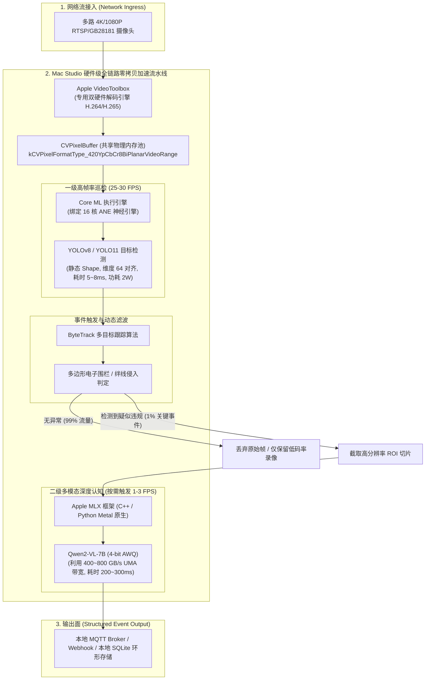

# 模块 1：Mac Studio 工业边缘计算中心节点落地指南与实时 Demo

> **定位**：基于 Apple Silicon 统一内存架构（UMA）的桌面边缘服务器（Edge Server / MEC）。  
> **核心优势**：400 ~ 800 GB/s 显存带宽、VideoToolbox 多路 4K 硬解、16 核 ANE（Apple Neural Engine）超低功耗常驻、Metal GPU 高并行多模态计算。

---

## 一、 系统架构全景 (Mac Studio Edge)

在工业安防、具身机器人主控和智慧制造产线中，Mac Studio 不是编译机，而是具备强大吞吐能力的**本地边缘智能中心**：



---

## 二、 核心底层技术规范

### 1. 突破 Memory-Bound：统一内存架构（UMA）
* **传统 x86 + PCIe 瓶颈**：主机内存与显存物理隔离，模型推理需要通过 PCIe 总线（带宽仅 32~64 GB/s）来回拷贝数据；在运行 7B~32B 大模型的自回归解码阶段（Decode），内存总线被频繁打满，生成速度极慢。
* **Mac Studio 优势**：CPU、GPU、ANE 共享片上统一物理内存，总线带宽高达 **400 GB/s ~ 800 GB/s**。
* **开发规范**：
  * 使用 Metal 创建 `MTLResourceStorageModeShared` 显存，多硬件指针直接互通，消除内存拷贝。
  * 采用 `mmap` 系统调用只读映射模型权重，秒级冷启动且杜绝双倍内存膨胀。

### 2. VideoToolbox $\to$ CVPixelBuffer 零拷贝直通
* 杜绝使用 CPU 软解（如原始 OpenCV `VideoCapture`），会导致多路拉流时 CPU 占用 100% 爆满。
* 使用 macOS 原生 **VideoToolbox** API，直接将 H.264/H.265 码流解入 `CVPixelBuffer`，其内存地址可直接包装为 Core ML 的输入 `MLFeatureValue`，全链路零拷贝。

### 3. ANE 100% 硬件卸载三军规
为了让轻量模型完全跑在超低功耗（1~3W）的 16 核 ANE 上：
1. **纯静态张量 Shape**：动态维度会导致 Core ML 自动回退（Fallback）到 GPU 或 CPU。
2. **张量对齐**：输入输出的宽高与通道数必须对齐为 **16 或 64 的整数倍**。
3. **预编译交付**：使用 `xcrun coremlcompiler compile model.mlpackage ./` 提前编译为 `.mlmodelc` 二进制文件。

---

## 三、 Mac Studio 可看效果的三大经典开源 Demo

无需自行从头编写复杂底层，以下三个工业级项目在 Mac Studio 上开箱即用，可立即看到效果：

### Demo 1：Scrypted（流媒体多路硬解 + ANE 目标检测旗舰）
* **项目特点**：工业界性能极强的流媒体服务器，原生支持 macOS ARM64。
* **直观效果**：Web 管理界面同时播放多路 4K RTSP 监控视频，开启 `@scrypted/coreml` 插件后，直接调用 Mac Studio 的 **16 核 ANE 运行 YOLO 检测人、车、宠物**，左侧实时显示目标框，CPU 占用率仅 3%~5%。
* **快速运行命令**：
  ```bash
  # 1. 使用 npx 一键拉起守护服务
  npx scrypted-cli install-server
  # 2. 浏览器访问管理后台
  open https://localhost:10443
  ```
* **效果体验**：在管理后台添加一个 RTSP 摄像头或本地视频文件，在 Plugins 中勾选 `Core ML Object Detector`，即可在实时视频画面上看到平滑的 AI 检测框。

---

### Demo 2：Ultralytics 实时摄像头 / 视频 Core ML 目标检测
* **项目特点**：最广泛采用的轻量级目标检测模型，原生支持导出 Core ML 并调用 macOS 摄像头进行可视化测试。
* **直观效果**：弹出一个原生 GUI 窗口，调用 Mac 摄像头（FaceTime 高清相机），实时画出人体、日常物品的目标检测框，右上角实时跳动当前 **FPS（通常可达 60fps 满帧）与单帧推理延迟（约 5~8ms）**。
* **快速运行命令**：
  ```bash
  # 1. 安装轻量推理库
  pip install ultralytics coremltools opencv-python
  
  # 2. 一键导出针对 ANE 优化的 Core ML 格式
  yolo export model=yolov8n.pt format=coreml nms=true
  
  # 3. 直接调用 Mac 本地摄像头实时预测并弹窗显示
  yolo predict model=yolov8n.mlpackage source=0 show=true
  ```

---

### Demo 3：Apple MLX 端侧多模态大模型（Qwen2-VL 工业认知）
* **项目特点**：苹果官方专为 Apple Silicon 设计的深度学习框架，完全基于 Metal 与统一内存构建。
* **直观效果**：在终端向多模态视觉模型（如 Qwen2-VL-7B 4-bit）输入一张现场监控图片或工业仪表图，并提问：“画面中工人是否穿戴了绝缘手套？”模型在 300ms 内直接输出自然语言研判报告，Decode 速度可达 35+ Tokens/s。
* **快速运行命令**：
  ```bash
  # 1. 安装苹果官方 MLX 多模态工具包
  pip install mlx-vlm
  
  # 2. 传入一张测试图片进行视觉语言推理
  python -m mlx_vlm.generate \
      --model mlx-community/Qwen2-VL-7B-Instruct-4bit \
      --image https://qianwen-res.oss-cn-beijing.aliyuncs.com/Qwen-VL/assets/demo.jpeg \
      --prompt "详细描述这张图片的内容以及场景中人物的状态。"
  ```
