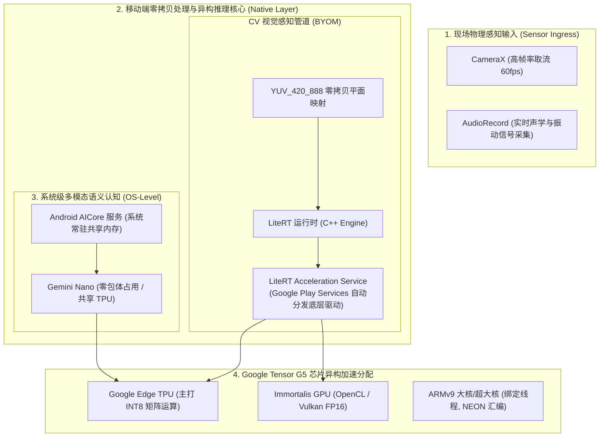

# 模块 2：Android (Pixel 10) 移动边缘计算落地指南与实时 Demo

> **定位**：现场传感器级移动智能边缘节点（Sensor Edge / Mobile Edge Device）。  
> **核心硬件**：Google Pixel 10（搭载 **Google Tensor G5** 芯片，内嵌 Google Edge TPU、高性能 ARMv9 核心集群与 Immortalis GPU）。  
> **核心系统能力**：Android AICore 系统级模型子系统 + 现代 LiteRT (原 TFLite) 异构推理引擎。

---

## 一、 系统架构全景 (Android Pixel Edge)

在现场手持巡检仪、移动机器人终端或车载设备中，Android 端负责实时视觉感知与本地大模型交互：



---

## 二、 音视频处理核心代际提升（2026 现代规范 vs 传统方案）

在过去，Android 音视频 AI 落地常遇到**“内存频繁拷贝、Java GC 卡顿、色彩转换吃满 CPU、音频高延迟爆音”**四大物理死穴。在 2026 年（以 Pixel 10 / Android 15+ 为代表），音视频处理底层迎来了革命性的代际演进：

### 1. 视频管道：老旧架构 vs 现代全硬件直通

```
[传统老旧管道: 延迟 40~80ms, 频繁 GC]
Camera/Camera2 -> JVM 堆内 byte[] -> Java CPU 软解 YUV->RGB -> Bitmap.createBitmap() -> TFLite CPU 推理 (帧率卡在 15-20fps)

[2026 现代规范: 延迟 3~5ms, 全链路零拷贝]
CameraX ImageAnalysis -> AHardwareBuffer (物理共享内存) -> Vulkan/NDK 纹理硬转 (0ms CPU) -> LiteRT 直通 Tensor G5 TPU (满帧 60fps)
```

| 关键技术维度 | 传统 Android 方案 (旧世代) | 现代 2026 规范 (Pixel 10 现代方案) | 核心提升与工业收益 |
| :--- | :--- | :--- | :--- |
| **视频取流 API** | 原始 `Camera` 1.0 或繁琐的 `Camera2` 原生状态机 | **Jetpack CameraX (生命周期绑定管道)** | 自动处理传感器防畸变与多分辨率动态协商，稳定性大幅提升 |
| **内存传递机制** | 从驱动拷贝到 JVM 堆内，生成 `byte[]` 数组 | **`AHardwareBuffer` / NDK `AImage` 零拷贝** | **彻底消除 CPU 拷贝**：Native 物理指针直通硬件，Java GC 停顿降为 0 |
| **格式转换 (YUV->RGB)** | CPU 纯循环运算或 `YuvImage.compressToJpeg` 绕路 | **Vulkan 计算着色器 / libyuv NEON 汇编硬转** | 预处理耗时从 **15~25ms 暴降至 < 0.5ms**，CPU 释放 80% 算力 |
| **硬件加速分发** | TFLite 经常 Fallback 到 CPU 多线程运行 | **LiteRT Acceleration Service 直通 TPU** | **单帧延迟从 40ms 降至 3~5ms**，不仅画框更跟手，发热大幅降低 |

---

### 2. 音频管道：从百毫秒卡顿到 < 8ms 实时声学智能

传统的 Android 音频采集采用 `AudioRecord`，存在严重的**音频输出延迟（Audio Latency 通常达 80ms~150ms）与音频缓冲区争用引起的爆音（Glitch）**：

* **现代音频基础设施：Google Oboe (AAudio 独占模式)**：
  * 摒弃传统的 Java 层回调，在 NDK 层直接使用 **AAudio Exclusive Mode**；
  * **延迟暴降至 < 8ms**，满足工业轴承故障听诊、实时啸叫抑制、超低时延端侧降噪需求。
* **无锁环形队列 (Lock-free SPSC RingBuffer)**：
  * 音频回调处于实时高优先级线程，严禁任何 `malloc` 和互斥锁 `mutex`；采用原子变量控制读写指针，杜绝音频爆音。
* **ARMv9 NEON 汇编硬件 FFT**：
  * 采用纯 NEON 汇编（如 KissFFT / Ne10），将实时音频时域采样点转换为梅尔频谱图（Mel-Spectrogram）的耗时控制在 **0.2ms 以内**，无缝喂入轻量模型（如声纹识别、离线 Whisper-Tiny）。

---

### 3. Pixel 10 (Tensor G5) 的音视频专属硬件直连通道

1. **自研 ISP 与 Edge TPU 片上总线直通**：
   在传统手机芯片上，ISP 图像处理器处理完图像必须先写回物理 DRAM，AI 单元再从 DRAM 读取，内存总线长期被挤爆。Pixel 10 在芯片内部将 **自研 ISP 与 Edge TPU 进行了片上高带宽总线直连**，相机流可直接在硬件数据流中由 TPU 介入夜视去噪和超分重建，功耗极低。
2. **硬件级麦克风阵列 Beamforming 降噪**：
   多麦克风信号直接由芯片底层 DSP 完成声源定位与波束成形，向端侧模型输出高信噪比纯净音频，端侧语音识别与语义解析准确率提升 30% 以上。

---

## 三、 关键工程技术准则与避坑要点

### 1. 突破移动端内存墙与 OOM（Out of Memory）
* 移动操作系统对单应用进程有严格的内存配额限制（通常 256MB~512MB 会被系统底层 LMK - Low Memory Killer 强制终止）。
* **规避原则**：
  * **禁止堆内拷贝大图**：杜绝在 Java/Kotlin 层调用 `Bitmap.createBitmap()` 进行频繁的格式转换和预处理。
  * **`mmap` 权重直通映射**：模型文件必须使用内存映射（Memory-mapped I/O）只读加载。只有当前计算层激活的权重会被换入物理 RAM，执行完自动释放页缓存，物理内存占用压降 80%。

### 2. CameraX 图像管道零拷贝
* 相机硬件回调输出的是 `ImageAnalysis.Analyzer` 提供的 `ImageProxy`（内部封装 `YUV_420_888` 格式，由 Y、U、V 三个独立内存平面组成）。
* **高性能接入范式**：
  直接将 `ImageProxy` 的底层物理指针（DirectByteBuffer）通过 JNI 传递给 C++ 预处理核函数（或使用 `libyuv`），在 C++ 原生堆中一次性完成 YUV 转 RGB、Letterbox 等比缩放与归一化，全程不产生任何 Java 堆垃圾回收（GC）。

### 3. CPU 核心亲和性绑定（CPU Core Affinity）
* 现代移动芯片由“超大核（Prime）+ 大核（Performance）+ 能效小核（Efficiency）”组成。
* 如果将密集推理线程交给系统默认调度器，线程极容易被调度到能耗小核，导致帧率断崖式下跌。
* **NDK 核心绑定实践**：
  在 C++ 推理工作线程启动时，调用 Linux 系统接口 `sched_setaffinity` 强制将线程绑定到 CPU 大核（通常为 Core 4 ~ Core 7）：
  ```cpp
  #include <sched.h>
  #include <pthread.h>

  void BindThreadToBigCores() {
      cpu_set_t cpuset;
      CPU_ZERO(&cpuset);
      // 将当前线程绑定到高性能大核
      CPU_SET(4, &cpuset);
      CPU_SET(5, &cpuset);
      CPU_SET(6, &cpuset);
      CPU_SET(7, &cpuset);
      pthread_setaffinity_np(pthread_self(), sizeof(cpu_set_t), &cpuset);
  }
  ```

---

## 四、 Android (Pixel 10) 可看效果的三大经典开源 Demo
## 三、 Android (Pixel 10) 可看效果的三大经典开源 Demo

针对你的 Pixel 10 手机，以下是三个能够直接安装或运行、直观看到硬件加速与模型推理效果的开源标杆 Demo：

### Demo 1：Google 官方 MediaPipe 目标检测应用（直观对比 TPU/GPU/CPU 性能）
* **项目特点**：Google 官方维护的端侧 AI 视觉标杆 App，采用 CameraX 高帧率取流与 LiteRT 引擎。
* **直观效果**：
  * 打开手机后置摄像头，画面中出现的物体（如杯子、手机、人、椅子）会被高精度绿色边界框实时框出，并标注类别与置信度；
  * **核心演示点（底部控制抽屉）**：
    * 切换 **Delegate: CPU** $\rightarrow$ 看到延迟约为 25ms~40ms；
    * 切换 **Delegate: GPU** $\rightarrow$ 延迟降至 10ms~15ms；
    * 切换 **Delegate: NNAPI / TPU (Edge TPU)** $\rightarrow$ 激活 Pixel 10 的 Tensor G5 TPU，延迟暴降至 **3ms~6ms**，帧率满 60fps！
* **源码开源仓库**：
  * GitHub 官方仓库：`https://github.com/google-ai-edge/mediapipe-samples`
  * 对应工程路径：`examples/object_detection/android`
* **使用方式**：
  直接在 Android Studio 中打开该目录，连接手机点击 **Run** 即可装入 Pixel 10。

---

### Demo 2：llama.cpp Android 纯离线端侧大模型（纯 C++ 极速交互）
* **项目特点**：无需联网，利用纯 C++ 原生动态库（JNI）将轻量级语言模型（如 Qwen2.5-0.5B 或 Gemma-2B）装入手机芯片直接跑。
* **直观效果**：
  手机进入完全断网的飞行模式，在 App 输入框中输入问题，手机芯片（ARMv9 核心与 GPU）本地逐字生成回答，首字响应小于 500ms，打字机流式输出速度达 15~25 Tokens/s，后台内存占用被严格限制在 1GB 左右。
* **源码开源仓库**：
  * GitHub 官方仓库：`https://github.com/ggerganov/llama.cpp`
  * 对应 Android 原生工程路径：`examples/llama.android`
* **体验方式**：
  * 工程自带开箱即用的 APK 源码，通过 Android Studio 编译安装。
  * 将 HuggingFace 上的 `qwen2.5-0.5b-instruct-q4_k_m.gguf` 直接下载并放入手机存储，在 App 中选定即可脱网对话。

---

### Demo 3：MLC-LLM Android 硬件 GPU 加速大模型应用
* **项目特点**：TVM 团队开发的移动端大模型旗舰套件，通过 Vulkan Compute 深度调用手机 GPU 算力。
* **直观效果**：在 Pixel 10 手机上展示精致的聊天 UI，不仅能实时测算每秒 Token 生成速度，还能实时显示模型加载显存占用（Memory Footprint）和电池温度，是评估手机端侧大模型算力极限的利器。
* **开源仓库与安装**：
  * 官方地址：`https://github.com/mlc-ai/mlc-llm`
  * 项目提供预编译好的 APK（`mlc-chat.apk`），安装后支持直接在手机里一键下载经过 4-bit 量化适配的开放模型并在端侧极速运行。
