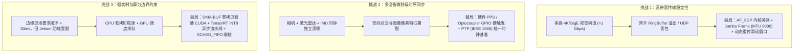
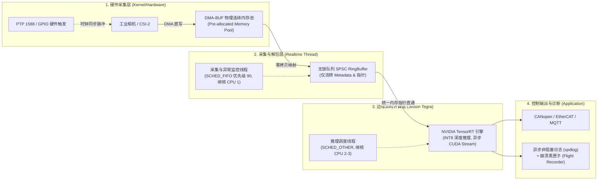

# 模块 3：NVIDIA Jetson 与嵌入式 Linux 工业边缘计算落地指南

> **核心定位**：工业视觉、具身机器人与边缘智能主控  
> **核心平台**：NVIDIA Jetson 系列（Orin Nano / Orin NX / AGX Orin）、嵌入式 Linux（L4T / Yocto / Ubuntu Core）  
> **核心使命**：解决高吞吐多源传感数据在严苛功耗与实时性约束下的“设备接入、低时延传输、零拷贝调度、硬件级同步、CUDA/TensorRT 边缘部署与系统容错”。

---

## 一、 边缘计算技术架构与核心子系统矩阵

在工业边缘现场与具身机器人场景中，边缘计算系统划分为五大核心技术子系统，对应底层的操作系统、网络协议栈与硬件加速技术：

| 系统模块 / 技术域 | 核心涉及的边缘计算技术 (Underlying Tech Stack) | 关键协议 / 规范 / 驱动库 | 工业落地核心指标 / 关注点 |
| :--- | :--- | :--- | :--- |
| **1. 传感器与设备接入层**<br>• 设备动态发现<br>• 连接生命周期管理<br>• 运行时参数控制<br>• 异常断线与自愈 | • **工业视觉标准协议栈**：GigE Vision (GVCP/GVSP)、USB3 Vision (U3V)、GenICam / GenTL 抽象层<br>• **多模态传感器接入**：LiDAR (UDP 原始点云)、深度相机 (RealSense/Orbbec)、IMU (SPI/I2C/UART/CAN/SocketCAN)<br>• **网络发现机制**：UDP 广播/组播探针、SSDP、mDNS、子网拓扑识别<br>• **设备状态机**：心跳保活、断线重连、XML 参数树动态解析、固件看门狗 (Hardware Watchdog) | Basler pylon, Hikrobot MVS, FLIR Spinnaker, librealsense, SocketCAN, libv4l2, GenICam Reference Version | • 发现耗时 < 500ms<br>• 断线重连无句柄泄漏<br>• 异常掉电参数掉电保存<br>• 现场即插即用 (Hot-plug) |
| **2. 数据传输与缓冲优化**<br>• 高吞吐带宽打满<br>• 微秒级低时延优化<br>• 传输丢包防御机制<br>• 零拷贝与队列调优 | • **网卡与内核网络旁路**：Jumbo Frames (MTU 9000)、NIC Ring Buffer 扩展、AF_XDP (XDP 零拷贝包捕获)<br>• **内存零拷贝机制**：V4L2 DMA-BUF、`mmap` 共享内存、POSIX 共享内存池 (`shm_open`)、EGLStream<br>• **内核级实时调度**：`SCHED_FIFO` / `SCHED_RR` 实时优先级、CPU 亲和性绑核 (`pthread_setaffinity_np`)、中断分发绑核 (`smp_affinity`)<br>• **并发数据结构**：SPSC / MPSC 无锁环形缓冲 (Lock-Free RingBuffer)、Disruptor 批处理模型<br>• **传输防丢包**：UDP 丢包重传请求 (Packet Resend)、滑动窗口流量控制、环形接收区预分配 | Linux Socket API, AF_XDP, DMA-BUF, `ethtool`, DPDK/XDP (极高吞吐场景) | • 10GbE 满载丢包率 = 0<br>• 采集端排队时延 < 2ms<br>• CPU 占用降低 40% (零拷贝)<br>• 内存碎片率 < 1% (预分配) |
| **3. 边缘异构推理与资源调度**<br>• Jetson BSP 平台适配<br>• CUDA / TensorRT 部署<br>• 板级能耗与显存调优<br>• 7x24h 稳定性保障 | • **Jetson BSP 底盘**：Linux for Tegra (L4T)、JetPack 5.x/6.x、Device Tree (DTS) 定制、CSI-2 / MIPI 驱动适配<br>• **Tegra 统一物理内存优化**：利用 CPU 与 GPU 共用 LPDDR5 物理内存特性，使用 `cudaHostAllocMapped` / Zero-Copy 消除 PCI-e 总线搬运开销<br>• **TensorRT 引擎调优**：ONNX 解析、Dynamic Shapes 优化、INT8 PTQ (校准集量化) / QAT 精度保全、多 CUDA Stream 异步并发<br>• **流媒体流水线集成**：NVIDIA DeepStream SDK、GStreamer 硬件插件 (`nvv4l2decoder`, `nvstreammux`, `nvinfer`, `nvtracker`)<br>• **板级能耗与热设计**：`nvpmodel` 功耗档位锁定 (如 15W/25W/MAXN)、`jetson_clocks` 频率锁定防抖动、动态降频保护 | NVIDIA JetPack, TensorRT C++ API, VPI (Vision Programming Interface), DeepStream SDK, CUDA Runtime | • 推理时延稳定方差 < 1ms<br>• INT8 吞吐提升 2~3 倍且精度下降 < 1%<br>• 长跑 7x24h 显存零增长<br>• 芯片结温 < 85℃ |
| **4. 硬件电气同步与现场定位**<br>• 多源传感器时间对齐<br>• 外部硬件电平触发协同<br>• 现场总线通信集成<br>• 运行期瓶颈分析诊断 | • **硬件触发与电气协同**：光耦隔离 GPIO 外部硬触发、PWM 补光灯/频闪仪毫秒级协同时序<br>• **高精度时间对齐**：IEEE 1588 PTP (Precision Time Protocol, `ptp4l`)、gPTP (802.1AS)、硬件 PPS (秒脉冲) 纳秒级授时<br>• **深度诊断与抓包工具链**：`wireshark` / `tcpdump` (深入解析 GVSP/GVCP 协议报文)、`strace` (系统调用分析)、`perf` / `ftrace` (内核延迟与上下文切换抓取)<br>• **全链路性能热点 Profiling**：NVIDIA Nsight Systems (`nsys`) 抓取 CPU-GPU-DMA-Stream 时间线、`tegrastats` 实时监控 EMC/GPU/DRAM 负载 | `ptp4l`, `phc2sys`, NVIDIA Nsight Systems, GDB / GDBServer, `perf`, Valgrind/ASan | • 传感器时序对齐误差 < 100μs<br>• 硬件触发抖动 < 10μs<br>• 崩溃 Dump 快速定位 (Core Dump + GDB 堆栈) |
| **5. 边缘系统高可靠与工程基盘**<br>• 异步低延迟遥测与日志<br>• 崩溃黑匣子与看门狗<br>• 嵌入式 C++ 安全规范<br>• 自动化交叉编译与仿真 | • **高性能异步日志**：无锁环形队列写盘 (`spdlog`, `quill`)，防止低时延采集线程被文件 I/O 阻塞<br>• **嵌入式健康遥测**：黑匣子内存飞行记录仪 (Flight Recorder)、Crashpad / Breakpad 崩溃捕获、Prometheus 边缘指标采集<br>• **现代 C++ 工业规范**：C++17/C++20、RAII 资源生命周期严格托管、移动语义减少深拷贝、`std::span` 零拷贝切片、MISRA C++ 安全基线<br>• **交叉编译与自动化**：Docker aarch64 容器化构建环境、CMake / CTest、GoogleTest 单元测试<br>• **工程仿真环境**：协议 Mock 服务端、压力测试仿真脚本、并发竞态检测工具链 | CMake, GoogleTest, spdlog, Docker, Gitlab CI/CD, Linux Watchdog API | • 关键路径日志开销 < 50ns<br>• 交叉编译与自动化构建一键产出<br>• 单元测试与端到端回归覆盖核心逻辑 |
---

## 二、 核心挑战 (Why it's hard) 的底层根因与工程破局之道



### 1. 深度剖析：高带宽传输稳定性
* **底层瓶颈**：1 台工业相机在 4K @ 60 FPS Bayer8 格式下吞吐量高达 `3840 * 2160 * 60 ≈ 497 MB/s`（~4 Gbps）。标准 Linux 内核网络协议栈（`sk_buff` 拷贝、软中断上下文切换、页缓存失效）在千兆/万兆突发下会导致 CPU 软中断打满（`ksoftirqd 100%`），网卡驱动 RX FIFO 迅速溢出导致整帧静默丢弃。
* **工业解法**：
  1. **巨型帧 (Jumbo Frames)**：将 MTU 从默认 1500 提升至 9000，单帧数据包由 6 个骤降为 1 个，网卡中断频率直接降低 80% 以上。
  2. **网卡缓冲扩容与绑核**：通过 `ethtool -G eth0 rx 4096` 将硬件接收环形队列拉满；通过 `/proc/irq/<irq_num>/smp_affinity` 将网卡中断硬绑定至特定非关键 CPU 核心。
  3. **预分配零内存分配**：数据传输主链路严禁任何动态 `malloc` / `new`，初始化阶段一次性预分配固定大小的 Frame Pool，采用环形无锁队列流转索引。

### 2. 深度剖析：多设备同步（时序对齐与多源一致性）
* **底层瓶颈**：多台工业相机若使用各自内部晶振计时，运行几小时后由于热漂移可能产生数十毫秒的时钟偏差；若使用软件发包触发，网络传输抖动（Jitter）可达毫秒级，导致双目/多目相机左右画面时间错位，运动物体产生致命“重影”与测距失败。
* **工业解法**：
  1. **硬件电平硬触发 (Master-Slave Trigger)**：由主控 GPIO 或硬件同步信号发生器发出 TTL 脉冲（周期方波），所有相机引脚接收沿触发曝光（曝光起始时间误差 < 5μs）。
  2. **协议级时钟同步 (IEEE 1588 / PTP)**：在 Linux 系统中部署 `ptp4l` 与 `phc2sys`，将 Jetson 的系统时钟（CLOCK_REALTIME）与网卡硬件时间戳单元（PHC）纳秒级对齐。相机采图时将硬件时间戳嵌入图像元数据，传输到主控后在时间同步缓冲区依据时间戳进行双向对齐融合（Time-synced Buffer）。

### 3. 深度剖析：实时性约束（端到端时延预算分析）
从光子打在传感器感光元件，到执行机构收到控制信号，工业现场通常有硬实时约束（如 < 30ms）：

```text
光子入眼 ──> 传感器曝光与读出 ──> 网卡接收与协议解包 ──> 内存转入显存 ──> 模型推理 ──> 业务控制决策 ──> PLC/CAN 执行
[ 0 ms ]      [ 5~10 ms ]           [ 1~2 ms ]         [ 0 ms 零拷贝 ]   [ 8~12 ms ]    [ 1~2 ms ]     [ < 30 ms 闭环 ]
```

* **破局核心**：
  - **消除内存搬运**：利用 Jetson 架构优势，采用 **V4L2 DMA-BUF** 或相机 SDK 的 Direct Memory Access，将采集缓冲直接映射到 CUDA 地址空间（Zero-Copy），消除传统架构中的 `Driver -> User Space -> CUDA Pinned Memory` 双重拷贝。
  - **CUDA Stream 异步双缓冲 (Double Buffering)**：推理流水线中，计算当前第 $N$ 帧的同时，异步传输第 $N+1$ 帧，使数据准备与 TensorRT 计算完全重叠（Overlap）。

---

## 三、 实战架构：工业级全链路零拷贝与异步处理流水线

在 Jetson 平台，业界最标准的嵌入式高性能视觉处理流采用 **三级解耦流水线**：



---

## 四、 核心技术代码骨架与工业级参考实现

### 1. 核心实战：SPSC 无锁环形缓冲区（C++17 工业级零动态分配）
针对高吞吐图像帧传递，彻底避免互斥锁（`std::mutex`）导致的线程挂起与上下文切换开销：

```cpp
#pragma once
#include <atomic>
#include <cstddef>
#include <array>
#include <optional>
#include <new>

// 缓存行大小，针对 aarch64 (Cortex-A78AE / Orin) 通常为 64 字节
constexpr size_t CACHE_LINE_SIZE = 64;

template <typename T, size_t Capacity>
class LockFreeSPSCQueue {
    static_assert((Capacity & (Capacity - 1)) == 0, "Capacity must be a power of 2");

public:
    LockFreeSPSCQueue() : head_(0), tail_(0) {}

    // 单生产者入队 (采集线程调用)
    template <typename... Args>
    bool emplace(Args&&... args) noexcept {
        const size_t current_tail = tail_.load(std::memory_order_relaxed);
        const size_t current_head = head_.load(std::memory_order_acquire);

        if ((current_tail - current_head) >= Capacity) {
            return false; // 队列满，由调用方决定丢帧策略
        }

        new (&buffer_[current_tail & BufferMask].storage) T(std::forward<Args>(args)...);
        tail_.store(current_tail + 1, std::memory_order_release);
        return true;
    }

    // 单消费者出队 (推理/处理线程调用)
    bool pop(T& val) noexcept {
        const size_t current_head = head_.load(std::memory_order_relaxed);
        const size_t current_tail = tail_.load(std::memory_order_acquire);

        if (current_head == current_tail) {
            return false; // 队列空
        }

        auto* ptr = reinterpret_cast<T*>(&buffer_[current_head & BufferMask].storage);
        val = std::move(*ptr);
        ptr->~T();

        head_.store(current_head + 1, std::memory_order_release);
        return true;
    }

private:
    static constexpr size_t BufferMask = Capacity - 1;

    struct Node {
        alignas(alignof(T)) std::byte storage[sizeof(T)];
    };

    std::array<Node, Capacity> buffer_;

    // 采用 Cacheline 填充，避免伪共享 (False Sharing)
    alignas(CACHE_LINE_SIZE) std::atomic<size_t> head_;
    alignas(CACHE_LINE_SIZE) std::atomic<size_t> tail_;
};
```

### 2. 核心实战：嵌入式 Linux 实时线程绑核与实时优先级设置
保障高带宽数据采集线程不被普通进程打断：

```cpp
#include <pthread.h>
#include <sched.h>
#include <iostream>
#include <cstring>

bool setup_realtime_thread(pthread_t thread, int cpu_core_id, int priority) {
    // 1. 设置 CPU 亲和性 (绑定到固定核心，避免跨核缓存失效)
    cpu_set_t cpuset;
    CPU_ZERO(&cpuset);
    CPU_SET(cpu_core_id, &cpuset);
    int rc = pthread_setaffinity_np(thread, sizeof(cpu_set_t), &cpuset);
    if (rc != 0) {
        std::cerr << "Error setting thread affinity: " << strerror(rc) << std::endl;
        return false;
    }

    // 2. 设置 FIFO 实时调度策略 (最高优先级响应采集)
    struct sched_param param;
    param.sched_priority = priority; // 范围 1-99，通常采集设为 80~90
    rc = pthread_setschedparam(thread, SCHED_FIFO, &param);
    if (rc != 0) {
        std::cerr << "Error setting SCHED_FIFO: " << strerror(rc) 
                  << " (Check CAP_SYS_NICE or sudo limits)" << std::endl;
        return false;
    }
    return true;
}
```

### 3. 核心实战：Jetson 平台物理连续内存 (DMA-BUF) 直通 CUDA 零拷贝
在 Jetson 架构上，利用 Unified Memory 将 V4L2 或硬件采集的共享内存句柄直接导入 CUDA，彻底免除 `cudaMemcpy` 消耗：

```cpp
#include <cuda_runtime.h>
#include <iostream>

// 将文件描述符 (DMA-BUF FD) 导入为 CUDA 设备可用外部内存 (CUDA External Memory)
cudaError_t import_dmabuf_to_cuda(int dmabuf_fd, size_t buffer_size, void** d_ptr) {
    cudaExternalMemoryHandleDesc mem_desc = {};
    mem_desc.type = cudaExternalMemoryHandleTypeOpaqueFd;
    mem_desc.handle.fd = dmabuf_fd;
    mem_desc.size = buffer_size;

    cudaExternalMemory_t ext_mem;
    cudaError_t err = cudaImportExternalMemory(&ext_mem, &mem_desc);
    if (err != cudaSuccess) {
        std::cerr << "cudaImportExternalMemory failed: " << cudaGetErrorString(err) << std::endl;
        return err;
    }

    cudaExternalMemoryBufferDesc buf_desc = {};
    buf_desc.offset = 0;
    buf_desc.size = buffer_size;
    buf_desc.flags = 0;

    err = cudaExternalMemoryGetMappedBuffer(d_ptr, ext_mem, &buf_desc);
    if (err != cudaSuccess) {
        std::cerr << "cudaExternalMemoryGetMappedBuffer failed: " << cudaGetErrorString(err) << std::endl;
        cudaDestroyExternalMemory(ext_mem);
        return err;
    }

    // 此时 *d_ptr 可直接作为 TensorRT 推理的 bindings 输入！无任何 CPU 拷贝
    return cudaSuccess;
}
```

### 4. 核心实战：AF_XDP (XDP 零拷贝) 内核旁路极速收包
在处理 >5 Gbps 的高帧率相机或激光雷达原始 UDP 数据包时，绕过标准内核 `sk_buff` 与软中断机制：

```cpp
#include <bpf/xsk.h>
#include <linux/if_link.h>
#include <sys/socket.h>
#include <iostream>
#include <vector>

constexpr size_t NUM_FRAMES = 4096;
constexpr size_t FRAME_SIZE = XSK_UMEM__DEFAULT_FRAME_SIZE; // 通常为 4096 字节

struct XdpUmemContext {
    struct xsk_umem_info* umem;
    struct xsk_ring_prod fq; // Fill Ring
    struct xsk_ring_cons cq; // Completion Ring
    void* buffer;
};

// 初始化 UMEM 内存池并绑定 AF_XDP Socket
int init_af_xdp_socket(const char* ifname, int queue_id, XdpUmemContext& ctx, struct xsk_socket_info*& xsk) {
    // 1. 分配对齐的内存块作为 UMEM
    size_t total_size = NUM_FRAMES * FRAME_SIZE;
    if (posix_memalign(&ctx.buffer, getpagesize(), total_size)) {
        return -1;
    }

    // 2. 创建 UMEM 并注册 Ring
    struct xsk_umem_config umem_cfg = {
        .fill_size = NUM_FRAMES / 2,
        .comp_size = NUM_FRAMES / 2,
        .frame_size = FRAME_SIZE,
        .frame_headroom = 0,
        .flags = 0
    };
    if (xsk_umem__create(&ctx.umem, ctx.buffer, total_size, &ctx.fq, &ctx.cq, &umem_cfg) < 0) {
        return -2;
    }

    // 3. 填充 Fill Ring 供网卡硬件 DMA 直写
    uint32_t idx = 0;
    if (xsk_ring_prod__reserve(&ctx.fq, NUM_FRAMES / 2, &idx) == NUM_FRAMES / 2) {
        for (size_t i = 0; i < NUM_FRAMES / 2; ++i) {
            *xsk_ring_prod__fill_addr(&ctx.fq, idx++) = i * FRAME_SIZE;
        }
        xsk_ring_prod__submit(&ctx.fq, NUM_FRAMES / 2);
    }
    return 0; // AF_XDP 准备完毕，驱动层零拷贝入队
}
```

### 5. 核心实战：边缘时钟同步 (PTP 1588 / 硬件时间戳解析)
在多源传感器（工业相机 + LiDAR + IMU）融合中，使用网卡物理硬件时间戳（SOF, Start of Frame）校准各设备：

```cpp
#include <linux/net_tstamp.h>
#include <linux/sockios.h>
#include <sys/ioctl.h>
#include <sys/socket.h>
#include <time.h>
#include <cstring>

// 启用套接字层硬件时间戳捕获 (PTP/PHC 纳秒级)
int enable_hardware_timestamp(int socket_fd, const char* ifname) {
    struct hwtstamp_config hw_cfg;
    std::memset(&hw_cfg, 0, sizeof(hw_cfg));
    hw_cfg.tx_type = HWTSTAMP_TX_OFF;
    hw_cfg.rx_filter = HWTSTAMP_FILTER_ALL; // 捕获所有接收包的硬件时间戳

    struct ifreq ifr;
    std::memset(&ifr, 0, sizeof(ifr));
    std::strncpy(ifr.ifr_name, ifname, sizeof(ifr.ifr_name) - 1);
    ifr.ifr_data = reinterpret_cast<char*>(&hw_cfg);

    if (ioctl(socket_fd, SIOCSHWTSTAMP, &ifr) < 0) {
        return -1; // 网卡硬件不支持或权限不足
    }

    int val = SOF_TIMESTAMPING_RAW_HARDWARE | SOF_TIMESTAMPING_RX_HARDWARE | SOF_TIMESTAMPING_SYS_HARDWARE;
    return setsockopt(socket_fd, SOL_SOCKET, SO_TIMESTAMPING, &val, sizeof(val));
}
```

### 6. 核心实战：边缘端硬件看门狗 (Hardware Watchdog) 守护
针对工业现场 7x24h 无人值守环境，当死锁或异常发生时触发硬件复位保障自愈：

```cpp
#include <fcntl.h>
#include <unistd.h>
#include <sys/ioctl.h>
#include <linux/watchdog.h>
#include <iostream>

class EdgeWatchdog {
public:
    bool init(const char* device = "/dev/watchdog", int timeout_secs = 10) {
        fd_ = open(device, O_WRONLY);
        if (fd_ < 0) return false;
        ioctl(fd_, WDIOC_SETTIMEOUT, &timeout_secs);
        return true;
    }

    void kick() noexcept {
        if (fd_ >= 0) {
            ioctl(fd_, WDIOC_KEEPALIVE, 0); // 喂狗，重置硬件倒计时
        }
    }

    ~EdgeWatchdog() {
        if (fd_ >= 0) {
            // 写入安全退出魔数 'V'，正常退出时不触发硬件重启
            write(fd_, "V", 1);
            close(fd_);
        }
    }
private:
    int fd_{-1};
};
```
---

## 五、 边缘工程核心技术难题与解决方案速查 (Cheatsheet)

1. **Q: 为什么 Jetson 上明明是统一内存，很多传统程序跑起来依然显存占用翻倍、性能很慢？**
   - **A**: 统一内存只代表**物理芯片是同一片 LPDDR**。如果不使用针对 Tegra 优化的 Zero-Copy API（如 `cudaHostAllocMapped`、`dma_buf` 或 `nvbufsurface`），传统的 `cudaMalloc` + `cudaMemcpy` 依然会在驱动层触发由 CPU 到“虚拟 GPU 空间”的同步内存拷贝和页表刷新，导致带宽浪费和双倍内存占用。
2. **Q: 面对千兆网工业相机，网络一旦波动出现持续丢包，如何设计采集恢复机制？**
   - **A**: 
     - **第一级（网卡层）**：开启网卡 Pause Frame 流量控制与 Jumbo Frames，扩大 RingBuffer。
     - **第二级（协议层）**：GVSP 启用 Packet Resend（基于包序号滑动窗口，超时未收包请求相机重发该小包）。
     - **第三级（应用层）**：设置每帧丢弃容忍阈值。若该帧重传超时仍不完整，立刻废弃该损坏帧并清空缓冲队列，绝不阻塞后续新帧的接收；连续丢包 $K$ 帧判定为网线松动或链路故障，状态机切入异常恢复流程（发送软件复位、重新绑定 Socket 并重启心跳线程）。
3. **Q: 如何保证边缘端程序长跑 7x24 小时不崩溃、不降频？**
   - **A**:
     - **锁频保稳**：通过 `jetson_clocks` 锁定频率，避开系统动态调频调压（DVFS）引起的延迟抖动。
     - **能耗档位固定**：根据散热条件配置 `nvpmodel -m <mode>`，确保不会因为瞬间超温被板级温度管理强制降频截断。
     - **内存绝不泄漏**：采用 AddressSanitizer (ASan) 配合长期压测，所有大块数据结构与 TensorRT Execution Context 在程序初始化时静态全部分配完毕，运行主循环严禁出现分配/释放操作。
4. **Q: 边缘计算场景下，为何必须优先选择 AF_XDP / DPDK 而非传统 Linux Socket 处理传感器原始码流？**
   - **A**: 传统 Linux 套接字每次收包都会触发网卡硬件中断、内核分配 `sk_buff` 结构、软中断协议栈解析以及用户态内核态拷贝（`copy_to_user`）。在万兆或多路 4K 视觉/LiDAR 场景下，每秒产生数十万甚至上百万个数据包，软中断（`ksoftirqd`）会迅速挤占全部 CPU 算力。AF_XDP 通过在网卡驱动层挂载 eBPF 程序，直接将数据包通过 DMA 写入预分配的用户态内存环（UMEM），完全旁路（Kernel Bypass）内核协议栈与内存拷贝，CPU 开销直接下降 70% 以上。
5. **Q: 工业现场多传感器时间对齐，为什么网络 NTP 无法胜任，必须采用 PTP 1588 / 硬件时间戳？**
   - **A**: NTP 是应用层协议，传输受路由器排队时延、操作系统调度抖动和网络拥塞影响，时钟精度通常只能达到毫秒级（1~10ms）。对于时速 30km/h 的 AGV/自动叉车，10ms 的时钟偏差将造成 8.3 厘米的空间测量撕裂。PTP (IEEE 1588) 配合网卡物理芯片（PHY/MAC）的硬件时间戳单元（PHC），直接在网线电平进出物理层瞬间打上时间戳，彻底消除协议栈排队抖动，可实现微秒至亚微秒级（<1μs）时间对齐。
6. **Q: 嵌入式 Linux 边缘工控机如何处理热失控（Thermal Throttling）与算力降级？**
   - **A**:
     - **降级预警**：实时通过 `sysfs`（如 `/sys/devices/virtual/thermal/`）轮询芯片核心温度与板级功耗。
     - **动态负载自适应**：设置三级温度阈值，第一级（>75℃）平滑降低非核心分析任务采样率；第二级（>80℃）自动关闭冗余后处理与密集日志，推理模型切换为轻量量化分支；第三级（>85℃）触发主动安全停车信号，保存现场黑匣子状态，避免硬件被动触发急停引发机械危险。
