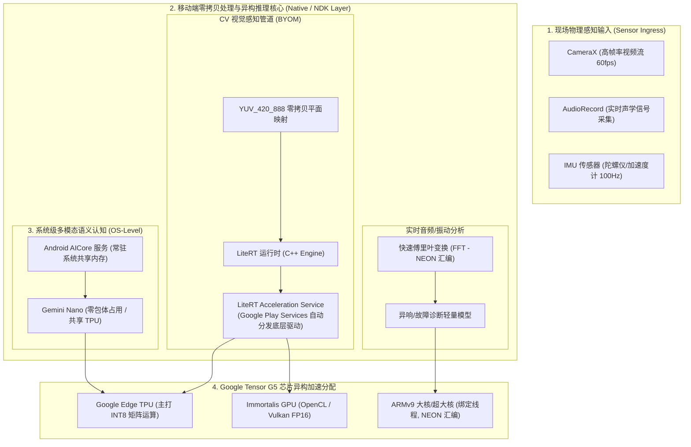

# 模块 2：Android (Pixel 10) 移动现场级边缘节点架构与落地规范

> **定位**：现场传感器级移动智能边缘节点（Sensor Edge / Mobile Edge Device）。  
> **核心硬件**：Google Pixel 10（搭载 **Google Tensor G5** 芯片，内嵌高并发 Google Edge TPU、高性能 ARMv9 核心集群与 Immortalis GPU）。  
> **核心系统能力**：Android AICore 系统级模型子系统 + 现代 LiteRT / ExecuTorch 异构推理引擎。

---

## 一、 系统架构与分层设计 (2026 规范)

在移动端边缘计算中，必须将业务解耦为 **系统级常驻服务（System Models）** 与 **业务专用自带模型（BYOM）** 两套并行流水线：



---

## 二、 关键工程技术准则与避坑要点

### 1. 突破移动端内存墙与 OOM（Out of Memory）
* 移动操作系统对单应用进程有严格的内存配额限制（通常 256MB~512MB 会被系统底层 LMK - Low Memory Killer 强制终止）。
* **规避原则**：
  * **禁止堆内拷贝大图**：坚决杜绝在 Java/Kotlin 层调用 `Bitmap.createBitmap()` 进行频繁的格式转换和预处理。
  * **`mmap` 权重直通映射**：模型文件必须使用内存映射（Memory-mapped I/O）只读加载。只有当前计算层激活的权重会被换入物理 RAM，执行完自动释放页缓存，物理内存占用压降 80%。

### 2. CameraX 图像管道零拷贝
* 相机硬件回调输出的是 `ImageAnalysis.Analyzer` 提供的 `ImageProxy`（内部封装 `YUV_420_888` 格式，由 Y、U、V 三个独立内存平面组成）。
* **高性能接入范式**：
  直接将 `ImageProxy` 的底层物理指针（DirectByteBuffer）通过 JNI 传递给 C++ 预处理核函数（或使用 `libyuv`），在 C++ 原生堆中一次性完成 YUV 转 RGB、Letterbox 等比缩放与归一化，全程不产生任何 Java 堆垃圾回收（GC）。

### 3. CPU 核心亲和性绑定（CPU Core Affinity）
* 现代移动芯片由“超大核（Prime）+ 大核（Performance）+ 能效小核（Efficiency）”组成。
* 如果将密集推理线程交给系统默认调度器，线程极容易被调度到能耗小核，导致帧率断崖式下跌。
* **NDK 核心绑定实践**：
  在 C++ 推理工作线程启动时，调用 Linux 系统接口 `sched_setaffinity` 强制将线程绑定到 CPU 大核（通常为 Core 4 ~ Core 7）：
  ```cpp
  #include <sched.h>
  #include <pthread.h>

  void BindThreadToBigCores() {
      cpu_set_t cpuset;
      CPU_ZERO(&cpuset);
      // 假设当前芯片的 Core 4, 5, 6, 7 为高性能核心
      CPU_SET(4, &cpuset);
      CPU_SET(5, &cpuset);
      CPU_SET(6, &cpuset);
      CPU_SET(7, &cpuset);
      pthread_setaffinity_np(pthread_self(), sizeof(cpu_set_t), &cpuset);
  }
  ```

---

## 三、 Android 端两大实操落地路线

### 路线 1：自带轻量模型落地（BYOM - LiteRT + TPU 加速）
1. **模型要求**：针对 Edge TPU，必须采用 **INT8 全整型量化（PTQ）**。
2. **Android 依赖配置 (`build.gradle.kts`)**：
   ```kotlin
   dependencies {
       // 现代 LiteRT 核心运行时
       implementation("com.google.ai.edge.litert:litert:1.0.1")
       // Google 官方硬件自动分发加速服务 (自动链接 Tensor G5 TPU)
       implementation("com.google.android.gms:play-services-tflite-acceleration-service:16.0.0-beta01")
       // CameraX 管道
       implementation("androidx.camera:camera-camera2:1.4.0")
       implementation("androidx.camera:camera-lifecycle:1.4.0")
       implementation("androidx.camera:camera-view:1.4.0")
   }
   ```

### 路线 2：系统内置大模型落地（Android AICore）
1. **适用场景**：实时多模态场景理解、现场离线语音文字转录、智能巡检报告生成。
2. **特点**：无需在 App APK 中打包动辄几个 GB 的大模型权重，直接调用系统级常驻服务，由操作系统保证在后台不被清理并共享硬件 TPU 资源。

---

## 四、 实施目录指引

本模块的代码与工程实战位于：
* `edge_ai_workspace/android_pixel_edge/native_benchmark/`：不带 UI 的纯 C++ 命令行可执行工具，通过 ADB 直接推送到手机 `/data/local/tmp` 测试芯片真实延迟与 FPS。
* `edge_ai_workspace/android_pixel_edge/app_skeleton/`：现代 Kotlin + Compose + CameraX + LiteRT 端侧 App 骨架工程。
