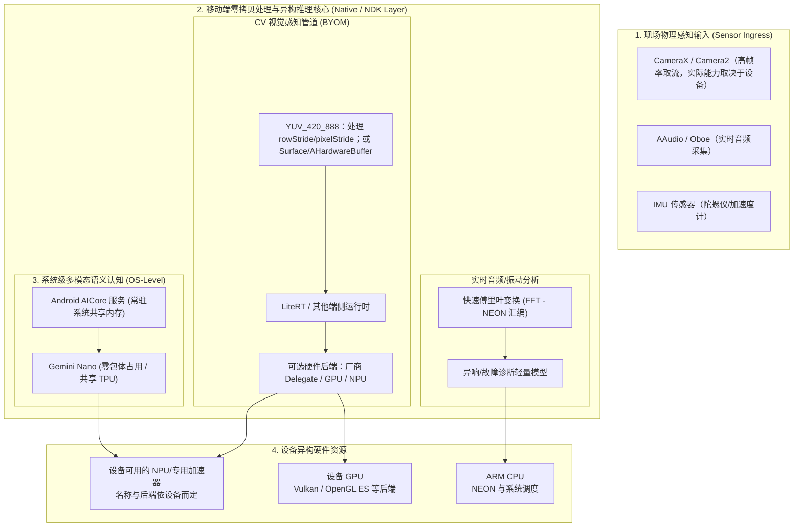

# 模块 2：Android (Pixel 10) 移动现场级边缘节点架构与落地规范

> **核心硬件**：Google Pixel 10（具体 SoC、加速器名称、驱动能力以设备实际规格和运行时枚举为准；不假定未公开的内部微架构）。  
> **核心系统能力**：CameraX/Camera2、NDK 音视频管线，以及 LiteRT、厂商 GPU/NPU 后端或其他端侧运行时；系统级模型能力取决于 Android 版本、地区、设备配置与 API。

---

## 一、 系统架构与分层设计 (2026 规范)

在移动端边缘计算中，必须将业务解耦为 **系统级常驻服务（System Models）** 与 **业务专用自带模型（BYOM）** 两套并行流水线：

---

## 二、 关键工程技术准则与避坑要点

### 1. 内存与资源管理
* Android 的可用内存受设备、应用进程、前台状态和系统压力共同影响，不应在文档中写死统一的 LMK 阈值。
* 避免在帧循环中创建大 Bitmap 或重复复制模型权重；模型是否支持内存映射、是否真正减少常驻内存，要由具体运行时和设备实测确认。
* 优先采用固定大小缓冲区、明确的帧丢弃策略和及时释放 `ImageProxy`，先控制延迟与峰值内存，再讨论零拷贝。

### 2. CameraX 图像管道：不要把 ImageProxy 当作紧凑连续内存
* `YUV_420_888` 的每个 Plane 都可能有不同的 `rowStride` 和 `pixelStride`；直接按 `width * height` 读取可能造成倾斜、花屏或越界。
* 通用稳妥路径是把三个 Plane 的 buffer、stride 和 pixel stride 交给 `libyuv`；极限路径才考虑 Surface/AHardwareBuffer 到 GPU 纹理的采样，并验证设备与后端是否支持真正的零拷贝。
* `ImageProxy.close()` 必须在消费完成后及时调用；使用 `STRATEGY_KEEP_ONLY_LATEST` 控制积压，避免延迟不断增长。

### 3. 音视频线程与调度
* `AAudio`（Android 8.0+）和 Oboe 是成熟的低延迟基础设施，不是 2026 年新 API。实时音频回调线程禁止阻塞、分配内存或执行复杂推理；使用无锁环形缓冲区把数据交给工作线程。
* 不要硬编码 CPU 核心编号。核心拓扑、频率和调度策略依设备而异；优先使用线程优先级、性能 hint 和运行时 profiling 验证收益。

---

## 三、 Android 端三类实操路线

### 路线 1：自带模型落地（LiteRT 或其他端侧运行时）
1. **模型要求**：输入输出、量化方式和可用硬件后端必须按目标设备实测；不能仅凭 `INT8` 就断言一定会进入 NPU。
2. **图像管线**：先用 CPU + `libyuv` 处理 stride，建立正确性基线；再根据设备支持情况评估 GPU、厂商 NPU Delegate 或其他后端。
3. **性能记录**：分别记录预处理、推理、后处理、端到端延迟和温度；不要把单一推理耗时当作 CameraX 实时帧率。

### 路线 2：系统级模型能力
系统模型或设备级 AI API 是否可用，取决于 Android 版本、Google Play 系统组件、地区、账户和设备配置。文档只应引用目标设备上实际可调用的公开 API，不把 AICore 或 Gemini Nano 视为所有 Android 设备的通用能力。

### 路线 3：低延迟音频 AI
使用 AAudio/Oboe 获取音频，回调线程只负责搬运到预分配的无锁环形缓冲区；FFT、特征提取和 ASR/声学模型在独立工作线程执行。需要 7×24 小时唤醒时，再核验设备是否公开提供低功耗 DSP/唤醒词 API。

---

## 四、 文档与 Demo 参考

本工作区只保留文档，不包含 Android 工程代码。可参考 Google AI Edge/MediaPipe Samples、Oboe、libyuv、Sherpa-ONNX 等项目，并在目标手机上实测可用后端。

---

