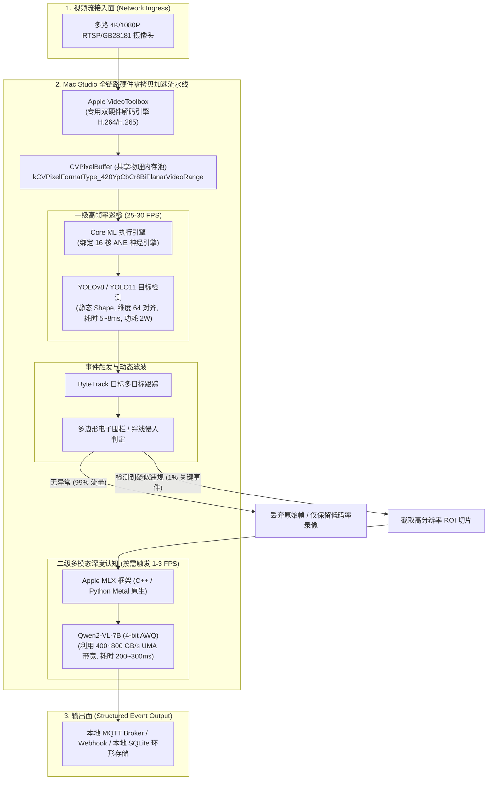

# 模块 1：Mac Studio 工业边缘计算中心节点架构与落地规范

> **定位**：基于 Apple Silicon 统一内存架构（UMA）的桌面边缘服务器（Edge Server / MEC）。  
> **核心优势**：400 ~ 800 GB/s 显存带宽、VideoToolbox 多路 4K 硬解、16 核 ANE（Apple Neural Engine）超低功耗常驻、Metal GPU 高并行多模态计算。

---

## 一、 系统架构与硬件算力拓扑

在安防边缘分析、工业质检中心站、机器人边缘主控中，Mac Studio 承担多路汇聚分析与大模型研判职责：



---

## 二、 核心技术栈与底层设计准则

### 1. 突破 Memory-Bound：统一内存架构（UMA）实操
* **传统 x86 + PCIe 瓶颈**：显卡显存独立，大模型自回归解码（Decode）受限于 PCIe 4.0/5.0（32~64 GB/s），且主机与显卡之间有冗余拷贝。
* **Mac Studio 落地规范**：
  * 使用 Metal 创建 `MTLResourceStorageModeShared` 缓冲区，CPU、GPU 与 ANE 共享物理页面，指针直接互通。
  * 部署 7B~32B 多模态模型时，统一内存直接消除了“模型加载时 CPU 内存翻倍”的缺陷，系统通过 `mmap` 秒级映射权重。

### 2. VideoToolbox $\to$ Core ML 零拷贝直通
* 绝不使用 OpenCV `VideoCapture`（避免触发 CPU 软解与逐帧内存拷贝）。
* **零拷贝代码范式**：
  使用 `AVFoundation` / `VideoToolbox` 解码出 `CVPixelBufferRef`，直接作为输入包装进 `VNImageRequestHandler` 或 Core ML 的 `MLFeatureValue`：
  ```objc
  // Objective-C++: 零拷贝喂入 Core ML
  CVPixelBufferRef pixelBuffer = ...; // 来自 VideoToolbox 解码输出
  id<MLFeatureProvider> input = [[YOLOInput alloc] initWithImage:pixelBuffer];
  id<MLFeatureProvider> output = [model predictionFromFeatures:input error:&error];
  ```

### 3. ANE 神经引擎 100% 卸载的“军规”
为了让模型完全跑在 1~3W 极低功耗的 ANE 核心上（而不占用 Metal GPU 计算资源）：
1. **纯静态张量 Shape**：动态 Batching 或动态宽高会直接导致 Core ML 回退（Fallback）到 GPU 或 CPU。
2. **张量对齐**：通道数与宽高必须是 16 或 64 的整数倍（匹配 ANE 硬件向量寄存器）。
3. **前置预编译**：交付物必须是编译后的 `.mlmodelc` 目录（通过 `xcrun coremlcompiler compile model.mlpackage ./` 生成）。

---

## 三、 两大生产级落地场景实现

### 场景 A：16 核 ANE 极速轻量感知（YOLO11 目标检测）
1. **模型导出（Python 端）**：
   ```bash
   pip install ultralytics coremltools
   python -c "from ultralytics import YOLO; model = YOLO('yolo11n.pt'); model.export(format='coreml', nms=True, imgsz=640)"
   ```
   * 参数 `nms=True`：直接将 Batched NMS（非极大值抑制）算子固化进 Core ML 计算图中，检测框解析由底层硬件自动完成。

### 场景 B：Apple MLX 驱动 Qwen2-VL 工业深度认知
对于复杂场景（如“判断机房巡检中机柜指示灯是否异常闪烁”、“工人是否正确穿戴全套安全吊绳”），规则算法难以覆盖，采用端侧多模态 VLM 进行二次研判：
1. **运行时选用**：采用 Apple 官方开源的 **MLX 框架**（专为 Apple Silicon 设计，兼备 PyTorch 般的灵活性与 Metal 原生极限性能）。
2. **量化标准**：采用 4-bit 权重量化（Group-Size 64 或 AWQ），模型体积压缩至 4.5GB，Decode 速度达 40+ Tokens/s。

---

## 四、 工业级开源套件集成推荐

| 开源项目 | 核心技术链路 | Mac Studio 部署方式与价值 |
| :--- | :--- | :--- |
| **Scrypted** (GitHub 15k+ ⭐) | Node.js + C++ / VideoToolbox / ANE 插件 | **音视频流媒体旗舰**：原生集成 VideoToolbox 解码与 `@scrypted/coreml` 目标检测，极低系统开销处理 16+ 路 RTSP |
| **Frigate NVR** (GitHub 18k+ ⭐) | Python / C / OpenVINO / WebUI | **工业安防报警中枢**：两阶段运动触发检测，支持电子围栏、绊线报警、录像联动 |
| **Roboflow Supervision** | Python 高性能跟踪与几何分析 | 提供标准的 ByteTrack 目标跟踪、多边形区域绊线计算、热力图统计，毫秒级输出事件 |

---

## 五、 实施目录指引

本模块的代码与工程实战位于：
* `edge_ai_workspace/mac_studio_edge/scripts/`：Core ML 导出脚本与 MLX 运行脚本。
* `edge_ai_workspace/mac_studio_edge/src/`：C++ / Objective-C 零拷贝硬解与推理示例。
* `edge_ai_workspace/mac_studio_edge/configs/`：Scrypted / Frigate 边缘工业配置文件。
